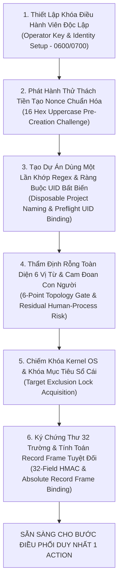
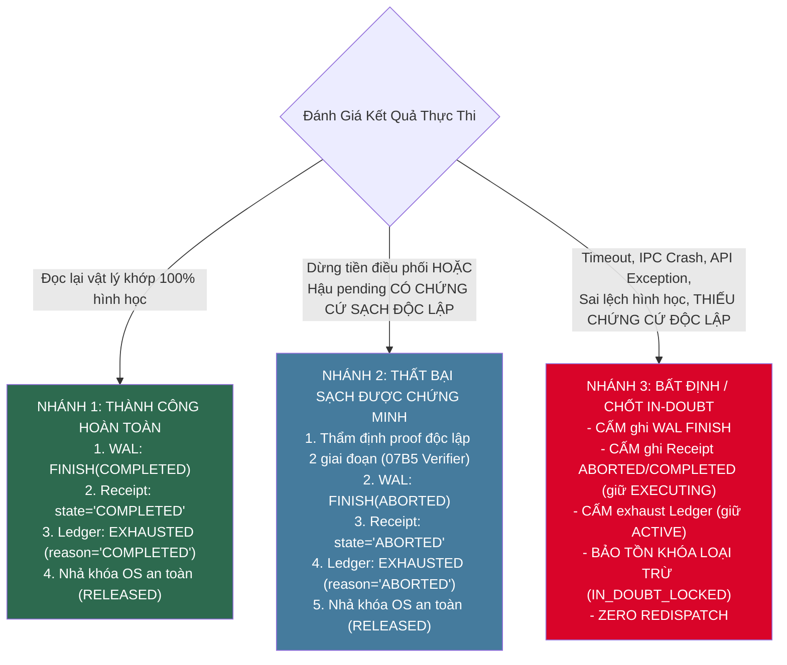
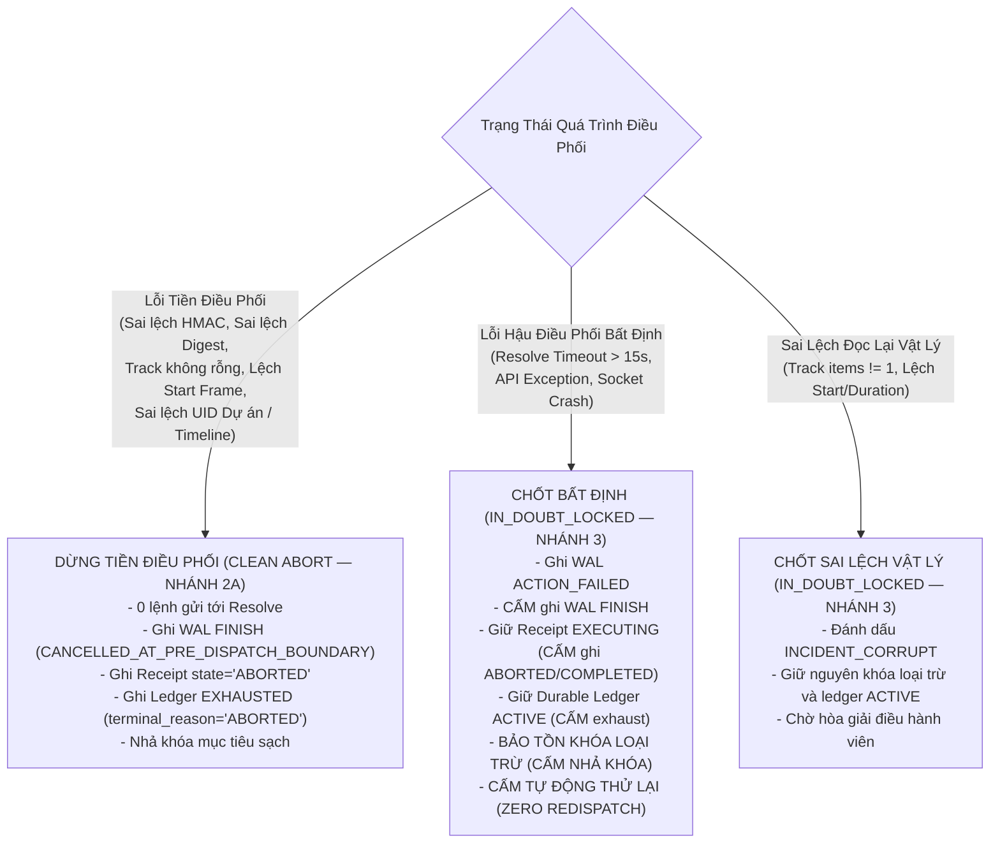
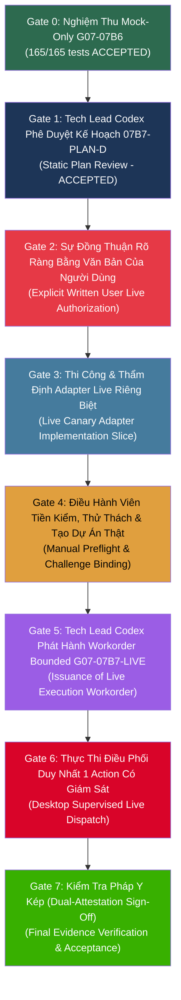

# Kế Hoạch Sẵn Sàng Thử Nghiệm Trực Tiếp Có Điều Hành Viên Giám Sát (Operator-Supervised Canary Readiness Plan — Revision R7)

**Workorder:** `G07-07B7-PLAN-D` (Revision R7)  
**Cổng Kiến Trúc (Parent Gate):** Gate G07 (Isolated Resolve Acceptance Gate / Live Canary Execution Gate)  
**Cột Mốc Tiền Nhiệm (Parent Milestone):** G07-07B6 ĐÃ ĐÓNG (Cả 4 lát cắt thi công mock-only I1, I2, I3, I4 đã được thẩm định và nghiệm thu ACCEPTED)  
**Chế Độ Thực Thi (Execution Mode):** `DESIGN_ONLY_LIVE_CANARY_READINESS_PLANNING`  
**Thẩm Quyền Thi Công:** **CHỈ THIẾT KẾ VÀ QUY HOẠCH SẴN SÀNG (DESIGN ONLY).** Bản kế hoạch này tuyệt đối không cấp quyền khởi chạy DaVinci Resolve, không cấp quyền kết nối IPC/FusionScript, và không cho phép thực hiện bất kỳ can thiệp trực tiếp nào lên timeline/project của Resolve.  
**Tài Liệu Căn Cứ & Dẫn Chiếu:**
- Tài liệu thiết kế gốc Gate G07: [`docs/architecture/07B5-isolated-resolve-acceptance-gate-design.md`](file:///media/vanntruongg/Documents/Development/Python/dự%20án%20cá%20nhân/ResolveFlow-Assistant/docs/architecture/07B5-isolated-resolve-acceptance-gate-design.md) (SHA-256: `e3dc16133e68648535f64dfc03592ed2f449ff6ae50438605e09d7f074df2132`).
- Kế hoạch thi công mock-only G07-07B6 V3: [`docs/architecture/07B6-mock-only-implementation-plan.md`](file:///media/vanntruongg/Documents/Development/Python/dự%20án%20cá%20nhân/ResolveFlow-Assistant/docs/architecture/07B6-mock-only-implementation-plan.md) (SHA-256: `628da41e58fc07c8b81ceadc1db42c8022fde5b1b315de6cf56fad0efec4f70a`).
- Đánh giá thẩm định R1 của Tech Lead Codex: [`docs/architecture/07B7-PLAN-D-code-review.md`](file:///media/vanntruongg/Documents/Development/Python/dự%20án%20cá%20nhân/ResolveFlow-Assistant/docs/architecture/07B7-PLAN-D-code-review.md) (SHA-256: `2dd62868bcd91e9430518740fa73285cb4f7ffb81c3fde7184ee9196e16266ef`).
- Đánh giá thẩm định R2 của Tech Lead Codex: [`docs/architecture/07B7-PLAN-D-R2-code-review.md`](file:///media/vanntruongg/Documents/Development/Python/dự%20án%20cá%20nhân/ResolveFlow-Assistant/docs/architecture/07B7-PLAN-D-R2-code-review.md) (SHA-256: `f7c58a2787a457af611ebd7de14ed1ff80e3f58aa15660eccdfc85205e589b8d`).
- Đánh giá thẩm định R3 của Tech Lead Codex: [`docs/architecture/07B7-PLAN-D-R3-code-review.md`](file:///media/vanntruongg/Documents/Development/Python/dự%20án%20cá%20nhân/ResolveFlow-Assistant/docs/architecture/07B7-PLAN-D-R3-code-review.md) (SHA-256: `596dcfe148ef3903a28cf72eae4c22f20cc9b6dc7becb8cb176875a8def8c537`).
- Đánh giá thẩm định R4 của Tech Lead Codex: [`docs/architecture/07B7-PLAN-D-R4-code-review.md`](file:///media/vanntruongg/Documents/Development/Python/dự%20án%20cá%20nhân/ResolveFlow-Assistant/docs/architecture/07B7-PLAN-D-R4-code-review.md) (SHA-256: `81e50deb9b7d6a221fc528f03696656f6ff903b5154b811c3e95d44413b05b06`).
- Đánh giá thẩm định R5 của Tech Lead Codex: [`docs/architecture/07B7-PLAN-D-R5-code-review.md`](file:///media/vanntruongg/Documents/Development/Python/dự%20án%20cá%20nhân/ResolveFlow-Assistant/docs/architecture/07B7-PLAN-D-R5-code-review.md) (SHA-256: `00e33bc8fc0fb927db6de459833f200958d5d698a8d761af679689903dc74f72`).
- Đánh giá thẩm định R6 của Tech Lead Codex: [`docs/architecture/07B7-PLAN-D-R6-code-review.md`](file:///media/vanntruongg/Documents/Development/Python/dự%20án%20cá%20nhân/ResolveFlow-Assistant/docs/architecture/07B7-PLAN-D-R6-code-review.md) (SHA-256: `2d5f08847ef23736986e7fad8f6c2de9f8d69e98ad1efc503ad2b596423bbaf4`).

---

## 1. PHẠM VI KIẾN TRÚC & PHÂN TÁCH THẨM QUYỀN AN TOÀN (SCOPE & AUTHORITY BOUNDARY)

### 1.1. Phân Tách Tuyệt Đối Giữa Phê Duyệt Kế Hoạch và Ủy Quyền Thi Công Thật (B7-PLAN-04)
1. **Phê Duyệt Kế Hoạch Sẵn Sàng (Plan Approval - Gate 1):**
   - Việc Tech Lead Codex thẩm định và chấp thuận (`ACCEPTED`) bản kế hoạch sẵn sàng này **CHỈ CÓ NGHĨA LÀ**: Khung kiến trúc, các điều kiện tiên quyết, ranh giới hình học, quy trình an toàn và ma trận nghiệm thu được thiết kế chặt chẽ, đầy đủ và hợp lệ về mặt kỹ thuật.
   - Việc phê duyệt kế hoạch này **TUYỆT ĐỐI KHÔNG ĐỒNG NGHĨA** với việc cấp quyền chạy can thiệp DaVinci Resolve thật.
2. **Ủy Quyền Thi Công Thật Từ Người Dùng (Explicit Written User Authorization - Gate 2):**
   - Bất kỳ workorder thi công trực tiếp trên DaVinci Resolve nào trong tương lai (`G07-07B7-LIVE`) **BẮT BUỘC PHẢI CÓ VĂN BẢN ĐỒNG THUẬN TRỰC TIẾP, RÕ RÀNG VÀ ĐỘC LẬP TỪ NGƯỜI DÙNG** trong phiên chat.
   - Bản kế hoạch này tuyệt đối không tự điền trước, không tự động suy diễn sự ủy quyền này từ việc người dùng yêu cầu lập kế hoạch, và nghiêm cấm việc nhảy cóc sang thi công khi người dùng chưa cung cấp văn bản ủy quyền tường minh.
3. **Bảo Tồn Bất Biến Rào Cản Toàn Hệ Thống:**
   - Cờ an toàn cốt lõi `ready_to_execute = False` được bảo tồn nghiêm ngặt.
   - Cổng G07 và các Cột mốc M1, M2, M3 duy trì trạng thái **MỞ (OPEN)**.
   - Cơ chế tripwire `_validate_mock_gateway_admission()` trong `ResolveExecutionEngine` và `ENGINE_MODE = "MOCK_ONLY"` được giữ nguyên trạng 100%.
   - Tuyệt đối không chỉnh sửa bất kỳ tệp tin nào trong `src/` hoặc `tests/` trong khuôn khổ workorder này.

---

## 2. TỔNG HỢP NỀN TẢNG BẰNG CHỨNG MOCK-ONLY ĐÃ ĐƯỢC CHẤP THUẬN (MOCK EVIDENCE BASELINE)

Giai đoạn thi công nguyên mẫu giả lập `G07-07B6` đã hoàn tất và được nghiệm thu chính thức bởi Tech Lead Codex qua 4 văn bản thẩm định cuối cùng:

| Lát Cắt Thi Công | Văn Bản Thẩm Định Cuối Cùng Của Tech Lead Codex | Quyết Định & Mã Băm SHA-256 Văn Bản Review | Năng Lực Kiến Trúc Đã Được Xác Lập |
|---|---|---|---|
| **Lát cắt I1** (`G07-07B6-I1`) | `docs/architecture/07B6-I1-R3-code-review.md` | **ACCEPTED**<br>`be4ef3652881c8154bbf9dbb9ad372be5f794916a412ceb3c564ccbd6ed3b879` | Hợp đồng DTO 32 trường bất biến `TrialExecutionAuthorization`; bộ lắp ráp payload 16 khóa chuẩn tắc; thuật toán tuần tự hóa RFC 8785 tất định; bộ quét từ vựng và hook chặn khóa trùng lặp JSON. |
| **Lát cắt I2** (`G07-07B6-I2`) | `docs/architecture/07B6-I2-R1-code-review.md` | **ACCEPTED**<br>`f749bb6d1a04cf252ee0249750bca06366d36709bb3892de9c1ccacf7d86da7b` | Cơ quan quản lý khóa nội bộ `TrialKeyringAuthority`; phân tách tuyệt đối giữa trial key và operator key; neo giữ descriptor thư mục `0700` và tệp `0600`; ranh giới entropy khóa 32–64 bytes. |
| **Lát cắt I3** (`G07-07B6-I3`) | `docs/architecture/07B6-I3-R2-code-review.md` | **ACCEPTED**<br>`b4c60a0fd1b7af5be5a9253c6c099582c3d84d763524c68479d1161bd0ed163f` | Sổ cái mục tiêu bền vững `DurableTrialTargetLedger`; cơ chế khóa đồng quy hai tầng (`threading.Lock` + `fcntl.flock`); bảo toàn khóa loại trừ khi gặp sự cố; cổng tiền tiếp nhận không đụng descriptor; giao thức hòa giải thử thách có TTL. |
| **Lát cắt I4** (`G07-07B6-I4`) | `docs/architecture/07B6-I4-R4-code-review.md` | **ACCEPTED**<br>`ed98fcbaccd668e92f12103815927bd002499ce78606c16d345b93c69ec1d3f2` | Cầu nối thử nghiệm cô lập `IsolatedResolveTrialAdapter`; tripwire chống giả mạo `FakeResolveGateway`; cổng kiểm tra digest SHA-256; chốt in-doubt có cấu trúc hậu điều phối; bảo toàn trạng thái `ACTIVE` bền vững qua crash/restart; đối chiếu toàn diện 8 trường danh tính trên ledger `RESERVED`. |

### Ranh Giới Khác Biệt Cốt Lõi Giữa Bằng Chứng Mock và Bằng Chứng Live
- **Kết quả kiểm thử mock:** 36/36 tests tập trung và 165/165 tests hồi quy kết hợp (0.72s) đã chứng minh tính đúng đắn logic của các DTO, thuật toán mật mã HMAC-SHA256, khóa kernel OS `flock`, và máy trạng thái nhật ký WAL.
- **Ranh giới chưa được xác minh:** Toàn bộ các kết quả mock-only trên **HOÀN TOÀN CHƯA CHỨNG MINH** hành vi tương tác thực tế với API C++ / Python của DaVinci Resolve, độ trễ và tính phi chặn của IPC socket, khả năng chấp nhận tệp media của Media Pool, và độ chính xác của thao tác chèn clip vào timeline thật.
- Bằng chứng mock-only chỉ đóng vai trò là **Điều Kiện Tiên Quyết Bắt Buộc (Necessary Prerequisite)** chứ tuyệt đối **Không Thể Thay Thế (Cannot Substitute)** cho việc nghiệm thu live có người giám sát.

---

## 3. CÁC ĐIỀU KIỆN TIÊN QUYẾT TIỀN THỰC THI & GIAO THỨC THỬ THÁCH TIỀN TẠO (PREFLIGHT PREREQUISITES & PRE-CREATION CHALLENGE PROTOCOL)

Căn cứ Section 2.7 (các dòng 3401–3410) và Section 3 của tài liệu thiết kế `07B5`, toàn bộ 6 nhóm điều kiện tiên quyết sau đây phải được thỏa mãn đầy đủ và đối soát tự động fail-closed:



### 3.1. Thiết Lập Danh Tính & Khóa Điều Hành Viên Độc Lập
1. Tệp khóa điều hành viên `operator_keys/<key_id>.opkey.json` phải tồn tại trong keystore, có quyền nghiêm ngặt `0600` thuộc sở hữu của tiến trình hiện tại, thư mục cha `0700`.
2. Khóa mang mục đích định danh bất biến `TIMELINE_AMBIGUOUS_RECONCILIATION`, entropy bí mật đạt từ 32 đến 64 bytes ngẫu nhiên mật mã.
3. Chuỗi danh tính điều hành viên con người (`operator_identity`) được chỉ định tường minh, liên kết chặt chẽ với chứng thư phê duyệt và biên bản bàn giao.

### 3.2. Giao Thức Thử Thách Tiền Tạo, Quy Ước Nonce & Ràng Buộc UID Bất Biến (B7-PLAN-03, B7-R2-01, B7-R2-03)
1. **Phát Hành Thử Thách Tiền Tạo & Chuẩn Hóa Nonce (Pre-Creation Challenge & Canonical Nonce Format):**
   - Trước khi điều hành viên tạo dự án trên Resolve, ứng dụng phát hành một mã thử thách ngẫu nhiên mật mã chuẩn tắc:
     ```python
     challenge_nonce = secrets.token_hex(8).upper()  # Chính xác 16 ký tự hexadecimal viết hoa [0-9A-F]{16}
     ```
   - Định dạng chuẩn tắc bắt buộc: Chuỗi ký tự độ dài chính xác 16 ký tự thuộc tập hợp `[0-9A-F]`.
   - Mã thử thách được lưu tạm có thời hạn (TTL hữu hạn 300.0s) và neo vào phiên chuẩn bị canary.
2. **Quy Tắc Đặt Tên Bắt Buộc Khớp Biểu Thức Chính Quy (Strict Regex & Exact Nonce Substring Matching):**
   - Điều hành viên tạo thủ công dự án mới trên DaVinci Resolve UI với tên bắt buộc khớp biểu thức chính quy:
     `^RF_TRIAL_[0-9A-Z_]{8,32}$`
   - Tên dự án **bắt buộc phải chứa mã `challenge_nonce`** (16 ký tự hex hoa) dưới dạng chuỗi con khớp tuyệt đối phân biệt chữ hoa/thường (case-sensitive exact substring):
     `auth.challenge_nonce in project_name`
   - Ví dụ tên dự án hợp lệ chuẩn tắc: `RF_TRIAL_4E2A8F1C0B3D5E7A` (tiền tố `RF_TRIAL_` gồm 9 ký tự kết hợp cùng nonce 16 ký tự, tổng độ dài 25 ký tự, hoàn toàn thỏa mãn giới hạn độ dài `[8, 32]`).
   - Cổng tiền tiếp nhận kiểm tra: Nếu tên dự án không khớp regex `^RF_TRIAL_[0-9A-Z_]{8,32}$` hoặc không chứa đúng `challenge_nonce` viết hoa, hệ thống từ chối ngay lập tức với `ERR_NON_DISPOSABLE_PROJECT`.
3. **Ràng Buộc Danh Tính Bất Biến Tại Cổng Tiền Kiểm (Preflight Immutable UID Binding — B7-R2-01):**
   - Truy vấn `project.GetUniqueId()` thành `target_project_uid`.
   - Tạo duy nhất 1 timeline và truy vấn `timeline.GetUniqueId()` thành `target_timeline_uid`.
   - Cả hai UID này được đóng băng trực tiếp vào chứng thư `TrialExecutionAuthorization`.
   - Bắt buộc lưu giữ hai định danh duy nhất này để đối chiếu bằng trực tiếp (equality check) tại cổng tiếp nhận của adapter và kiểm tra lại ngay trước thời điểm dispatch (xem Mục 4.2 và Mục 5.2.1).

### 3.3. Thẩm Định Rỗng Toàn Diện & Rủi Ro Quy Trình Con Người Tồn Đọng (B7-PLAN-03, B7-R2-04)
Căn cứ Section 2.7 (bảng vị từ dòng 3404), timeline canary bắt buộc phải thỏa mãn 100% các vị từ topology và độ tươi mới sau đây:
1. `timeline.GetTrackCount("video") == 1`: Timeline chỉ có duy nhất 1 Video Track (V1).
2. `timeline.GetTrackCount("audio") <= 1`: Timeline có tối đa 1 Audio Track (A1).
3. `len(timeline.GetItemListInTrack("video", 1)) == 0`: Track V1 hoàn toàn rỗng (chính xác 0 clip).
4. Nếu có track audio: `len(timeline.GetItemListInTrack("audio", 1)) == 0` (chính xác 0 clip).
5. `timeline.GetStartFrame() == timeline.GetEndFrame()`: Độ dài timeline bằng 0 khung hình (bằng chứng toán học xác nhận không có clip ẩn/rác).
6. `len(timeline.GetMarkers()) == 0`: Chính xác 0 markers trên toàn bộ timeline.
7. **Cam Đoan Tính Mới Của Con Người (Human Freshness Attestation):** Điều hành viên ký xác nhận dự án và timeline vừa được tạo mới hoàn toàn, không chứa bất kỳ dữ liệu sản xuất nào.
- **Quy tắc fail-closed:** Nếu bất kỳ truy vấn API nào trên đây bị lỗi, không được hỗ trợ bởi phiên bản Resolve, hoặc trả về giá trị không khớp vị từ $\rightarrow$ Từ chối tiếp nhận với `ERR_TRIAL_TARGET_FRESHNESS_UNVERIFIED`.
- **Rủi ro quy trình con người tồn đọng & Giới hạn của bộ lọc tên (Residual Human-Process Risk & Admission Filter Nature — B7-R2-04):**
  Quy tắc đặt tên dự án theo biểu thức chính quy `^RF_TRIAL_[0-9A-Z_]{8,32}$` và mã thử thách `challenge_nonce` đóng vai trò là **bộ lọc tiếp nhận ban đầu (admission filter only)** chứ không thể tự thiết lập hay đảm bảo xuất xứ/danh tính thật của đối tượng DaVinci Resolve. Do thao tác tạo dự án được thực hiện thủ công bởi con người trên giao diện DaVinci Resolve, vẫn tồn tại rủi ro điều hành viên thao tác nhầm trên project khác nếu không tuân thủ nghiêm ngặt quy trình tác nghiệp. Việc kết hợp kiểm tra bộ lọc này cùng với cơ chế ràng buộc và đối soát bằng tuyệt đối UID bất biến (`target_project_uid`, `target_timeline_uid`) tại cả cổng tiếp nhận lẫn trước điều phối, kết hợp sự kiểm tra trực tiếp của điều hành viên, giúp giảm thiểu đáng kể nguy cơ thao tác nhầm trên dự án khác. Tuy nhiên, rủi ro quy trình con người tồn đọng này vẫn hiện hữu và không bị triệt tiêu hoàn toàn bởi việc đặt tên dự án; điều hành viên phải chịu trách nhiệm tuân thủ danh mục kiểm tra thủ công.

### 3.4. Đăng Ký Tệp Nguồn Thử Nghiệm Chuẩn Hóa (Canary Source Media)
1. Tệp video nguồn là tệp kiểm chuẩn cục bộ tĩnh đã được kiểm chứng (clip test SMPTE Color Bars 1080p24 độ dài chuẩn).
2. Đường dẫn tệp `source_file_path` là đường dẫn tuyệt đối, nằm trên ổ đĩa cục bộ (không dùng mạng/SMB).
3. Ghi nhận và thẩm định dấu vết pháp y: `st_size`, `st_dev`, `st_ino`, và mã băm SHA-256 nội dung của tệp nguồn khớp 100% với `SourceFileDigestBinding`.
4. Tỷ lệ khung hình (FPS) của tệp nguồn phải khớp chính xác với `project.GetSetting("timelineFrameRate")`.

### 3.5. Chiếm Khóa Loại Trừ Cấp Hệ Điều Hành (Target Exclusion Lock)
1. Gọi `coordinator.acquire_target_lock(target_timeline_uid)`: Chiếm giữ `threading.Lock()` nội bộ và khóa kernel độc quyền `fcntl.flock(fd, LOCK_EX | LOCK_NB)` trên `.locks/{ident_hash}.lock`.
2. Xác nhận `coordinator.has_target_lock(target_timeline_uid) is True`.

### 3.6. Ký Chứng Thư Ủy Quyền 32 Trường & Tính Toán Record Frame Tuyệt Đối (B7-PLAN-02)
1. Lập chứng thư `TrialExecutionAuthorization` 32 trường đầy đủ theo Section 2.3 của `07B5`.
2. **Khung Hình Ghi Nhận Vật Lý Tuyệt Đối (`authorized_record_frame`):**
   - Đọc khung hình gốc vật lý của timeline: `observed_timeline_start_frame = timeline.GetStartFrame()` (ví dụ `86400` đối với timecode 01:00:00:00, hoặc `0`).
   - Đặt vị trí tương đối timeline: `authorized_timeline_frame_start = 0`.
   - Tính toán và ràng buộc bất biến:
     $$\text{authorized\_record\_frame} = \text{observed\_timeline\_start\_frame} + \text{authorized\_timeline\_frame\_start}$$
   - Giá trị tuyệt đối `authorized_record_frame` được ghi trực tiếp vào chứng thư và được bảo vệ bằng chữ ký HMAC-SHA256 32 trường.
3. Lắp ráp canonical payload 16 khóa và tính toán `action_payload_digest_sha256 = sha256(canonical_action_payload_bytes(payload))`.

---

## 4. KHUÔN KHỔ THỰC THI DUY NHẤT 1 HÀNH ĐỘNG VÀ ĐỐI CHIẾU DANH TÍNH TẠI RANH GIỚI CUỐI (SINGLE-ACTION EXECUTION ENVELOPE & DISPATCH IDENTITY BOUNDARY)

### 4.1. Định Danh Hành Động Duy Nhất Được Phép Thực Thi (Section 2.7 của 07B5)
Hành động duy nhất được phép thực thi trong toàn bộ phiên canary live là:
- **`action_type`:** `"INSERT_CLIP"` (khớp 100% với Section 2.7 dòng 3402 của `07B5`).
- **`track_type`:** `"video"`
- **`track_index`:** `1` (Video Track 1)
- **`source_frame_start`:** `0`
- **`source_frame_duration`:** `120` (Đúng $120$ khung hình $\equiv$ 5.0 giây tại 24.0 fps)
- **`timeline_frame_start`:** `0` (vị trí tương đối ở đầu timeline)
- **`timeline_frame_duration`:** `120`
- **`authorized_record_frame`:** Khung hình tuyệt đối được tính toán theo Section 3.6 (ví dụ `86400` hoặc `0`).

### 4.2. Ràng Buộc Khung Hình Vật Lý & Đối Chiếu Bắt Buộc UID Dự Án / Timeline Ngay Trước IPC (B7-PLAN-02, B7-R2-01)
Tại thời điểm phát lệnh gọi IPC tới DaVinci Resolve Scripting API:
1. Adapter đọc trực tiếp giá trị `auth.authorized_record_frame` từ chứng thư đã được ký số HMAC.
2. Adapter **TUYỆT ĐỐI KHÔNG TÍNH LẠI** khung hình chèn bằng biểu thức runtime khác.
3. **Đối Chiếu Bắt Buộc UID Dự Án & Timeline Đang Hoạt Động (Mandatory Active UID Equality Checks Before Dispatch — B7-R2-01):**
   Trước khi thực hiện bất kỳ lệnh đột biến nào (`media_pool.AppendToTimeline()`), adapter **bắt buộc phải thực hiện truy vấn tươi** các đối tượng đang hoạt động và so sánh bằng trực tiếp với `auth.target_project_uid` và `auth.target_timeline_uid`. Bất kỳ lỗi truy vấn, đối tượng None, chuỗi rỗng hoặc giá trị không trùng khớp 100% đều kích hoạt hủy bỏ an toàn fail-closed ngay lập tức trước khi chạm vào IPC:
   ```python
   # 1. Thẩm định danh tính Dự án Đang Hoạt Động (Active Project UID Equality Check)
   active_project = resolve.GetProjectManager().GetCurrentProject()
   if active_project is None:
       raise TargetProjectMismatchError("ERR_NO_ACTIVE_PROJECT_PRE_IPC: Không tìm thấy active project")
   active_proj_uid = active_project.GetUniqueId()
   if not isinstance(active_proj_uid, str) or active_proj_uid != auth.target_project_uid:
       raise TargetProjectMismatchError(
           f"ERR_TARGET_PROJECT_UID_DRIFT_PRE_IPC: Active project UID '{active_proj_uid}' "
           f"không khớp với target_project_uid đã ký '{auth.target_project_uid}'"
       )

   # 2. Thẩm định danh tính Dòng Thời Gian Đang Hoạt Động (Active Timeline UID Equality Check)
   active_timeline = active_project.GetCurrentTimeline()
   if active_timeline is None:
       raise TargetTimelineMismatchError("ERR_NO_ACTIVE_TIMELINE_PRE_IPC: Không tìm thấy active timeline")
   active_tl_uid = active_timeline.GetUniqueId()
   if not isinstance(active_tl_uid, str) or active_tl_uid != auth.target_timeline_uid:
       raise TargetTimelineMismatchError(
           f"ERR_TARGET_TIMELINE_UID_DRIFT_PRE_IPC: Active timeline UID '{active_tl_uid}' "
           f"không khớp với target_timeline_uid đã ký '{auth.target_timeline_uid}'"
       )

   # 3. Thẩm định trôi dạt khung hình gốc độc lập (Timeline Start Frame Drift Check)
   current_start_frame = active_timeline.GetStartFrame()
   if current_start_frame != auth.observed_timeline_start_frame:
       raise TargetTimelineShiftedError(
           f"ERR_TIMELINE_START_FRAME_DRIFT_PRE_IPC: Timeline start frame bị dịch chuyển "
           f"từ {auth.observed_timeline_start_frame} sang {current_start_frame} ngay trước khi dispatch"
       )

   # 4. Truyền chính xác authorized_record_frame đã được ký số vào lệnh IPC
   media_pool.AppendToTimeline([{
       "mediaPoolItem": clip_item,
       "startFrame": auth.authorized_source_frame_start,
       "endFrame": auth.authorized_source_frame_start + auth.authorized_source_frame_duration,
       "trackIndex": auth.authorized_track_index,
       "recordFrame": auth.authorized_record_frame,
   }])
   ```

### 4.3. Danh Mục Các Thao Tác Bị CẤM TUYỆT ĐỐI (Strictly Prohibited Operations)
1. **CẤM** chèn bất kỳ clip âm thanh (Audio) nào trong phiên canary này.
2. **CẤM** thực hiện bất kỳ thao tác cắt (split), xóa (ripple delete), hoặc dịch chuyển (move) clip có sẵn.
3. **CẤM** áp dụng Color Grade, LUT, hoặc Fusion Composition Script.
4. **CẤM** thực hiện lệnh Render, Export, hoặc Delivery.
5. **CẤM** thực hiện bất kỳ thao tác nào vượt quá giới hạn 1 action nêu trên. Mọi kế hoạch có $\ge 2$ hành động sẽ bị từ chối fail-closed.

### 4.4. Xác Nhận Đọc Lại Vật Lý (Physical Timeline Read-Back — B7-PLAN-02)
Sau khi `AppendToTimeline` hoàn thành:
1. Truy vấn danh sách clip thực tế trên Video Track 1: `items = active_timeline.GetItemListInTrack("video", 1)`.
2. Xác thực đối soát hình học vật lý nghiêm ngặt:
   - `len(items) == 1`: Track V1 chứa chính xác 1 clip.
   - `items[0].GetStart() == auth.authorized_record_frame`: Vị trí bắt đầu vật lý khớp 100% với khung hình ghi nhận tuyệt đối đã ký.
   - `items[0].GetDuration() == auth.authorized_timeline_frame_duration`: Thời lượng clip đúng bằng $120$ khung hình.
   - `items[0].GetEnd() == auth.authorized_record_frame + auth.authorized_timeline_frame_duration`.
   - `items[0].GetName()` khớp với tên tệp của canary source media.

---

## 5. KIẾN TRÚC THI CÔNG LIVE, TRIPWIRE HAI TẦNG & GIAO DỊCH HOÀN TẤT BỀN VỮNG (LIVE ARCHITECTURE, TWO-TIER TRIPWIRE & DURABLE TRANSACTION ORDER)

### 5.1. Phân Tích Rào Cản Của Adapter Mock-Only Hiện Tại
- Lát cắt `G07-07B6-I4` đã thi công module `IsolatedResolveTrialAdapter` ([`src/services/isolated_resolve_trial_adapter.py`](file:///media/vanntruongg/Documents/Development/Python/dự%20án%20cá%20nhân/ResolveFlow-Assistant/src/services/isolated_resolve_trial_adapter.py)).
- Adapter này sở hữu tripwire cố tình chỉ chấp nhận `type(gateway) is FakeResolveGateway` và từ chối mọi gateway có thuộc tính Resolve thật (`ERR_LIVE_ADAPTER_REJECTED`).
- Đồng thời, adapter I4 cố tình để ledger ở trạng thái `ACTIVE`, không tạo `TrialExecutionReceipt` trên đĩa và không gọi `exhaust_target()` (được Tech Lead Codex nghiệm thu tại R4 để ngăn ngừa việc ghi nhận hoàn tất giả khi chưa có biên bản).
- **Hệ quả kiến trúc:** Không thể sử dụng trực tiếp `IsolatedResolveTrialAdapter` hiện tại để điều phối live Resolve mà không vi phạm ranh giới tripwire mock-only đã được đóng băng an toàn.

### 5.2. Điều Kiện Tiên Quyết Thi Công Cho Giai Đoạn Live (Implementation Prerequisites Before Live Execution)
Trước khi workorder thi công trực tiếp `G07-07B7-LIVE` có thể được kích hoạt, một lát cắt thi công mở rộng an toàn riêng biệt phải được thiết kế và review:

#### 5.2.1. Module Adapter Canary Trực Tiếp Riêng Biệt (`LiveResolveCanaryAdapter`) & Tripwire Hai Tầng (B7-R2-01, B7-R2-03)
1. Được xây dựng trong một tệp mã nguồn riêng biệt (`src/services/live_resolve_canary_adapter.py`), tách rời hoàn toàn khỏi adapter mock-only I4.
2. Được trang bị **Tripwire Tiếp Nhận & Điều Phối Hai Tầng (Two-Tier Live Canary Tripwire)**:
   - **Tầng 1 — Cổng Tiếp Nhận Ban Đầu (Admission Gate Tripwire):**
     * Kiểm tra tên dự án khớp regex `^RF_TRIAL_[0-9A-Z_]{8,32}$`.
     * Kiểm tra `auth.challenge_nonce in project.GetName()` (khớp chuỗi con phân biệt hoa/thường của 16 ký tự hex hoa).
     * **Bắt buộc đối chiếu bằng trực tiếp UID (Admission UID Equality):**
       `project.GetUniqueId() == auth.target_project_uid`
       `timeline.GetUniqueId() == auth.target_timeline_uid`
     * Nếu thiếu UID, API trả về None/rỗng, hoặc sai lệch dù chỉ 1 ký tự $\rightarrow$ Từ chối ngay lập tức với `ERR_TARGET_PROJECT_UID_MISMATCH` hoặc `ERR_TARGET_TIMELINE_UID_MISMATCH`.
   - **Tầng 2 — Cổng Tiền Điều Phối Ngay Trước IPC (Pre-IPC Boundary Tripwire):**
     * Thực hiện truy vấn lại tươi `active_project.GetUniqueId()` và `active_timeline.GetUniqueId()`.
     * Đối chiếu nghiêm ngặt với `auth.target_project_uid` và `auth.target_timeline_uid` như đã mô tả chi tiết tại Mục 4.2.
     * Kiểm tra trôi dạt khung hình gốc `active_timeline.GetStartFrame() == auth.observed_timeline_start_frame`.
3. Giữ nguyên 100% cơ chế tripwire `_validate_mock_gateway_admission()` của `ResolveExecutionEngine` sản xuất (động cơ sản xuất tiếp tục ở chế độ `MOCK_ONLY`).

#### 5.2.2. Trình Tự Giao Dịch Bền Vững Chuẩn 07B5, Ba Nhánh Kết Thúc Phân Lập & Quy Trình Thẩm Định Bằng Chứng Hai Giai Đoạn (07B5 Durable Transaction Order, Three Discrete Terminal Branches & Two-Stage Proof Verification Contract — B7-PLAN-01, B7-R2-02, B7-R3-01, B7-R4-01, B7-R5-01)

Căn cứ hợp đồng giao dịch hoàn tất tại Section 2.6 (Mục 10–11 dòng 1186–1334) của tài liệu thiết kế `07B5`, hệ thống phân lập 3 nhánh kết thúc rạch ròi. Bộ ba trạng thái kết thúc `(WAL.final_receipt_state, Receipt.state, Ledger.terminal_reason)` **bắt buộc phải có giá trị ngữ nghĩa đồng nhất 100%**, nghiêm cấm mọi sự lệch pha hoặc suy diễn trạng thái sạch chỉ từ bản ghi WAL cục bộ:



1. **Nhánh 1 — Thành Công Hoàn Toàn Được Xác Thực Vật Lý (Verified Success Branch):**
   - **Điều kiện kích hoạt:** Đột biến IPC thành công VÀ đọc lại vật lý xác nhận clip chèn vào Video Track 1 khớp 100% hình học (`items[0].GetStart() == auth.authorized_record_frame`, thời lượng 120 frames).
   - **Bước 1 (WAL Terminal):** Ghi bản ghi `FINISH` vào WAL với `note="COMPLETED_ALL_ACTIONS"`, `final_receipt_state="COMPLETED"` và fsync đĩa.
   - **Bước 2 (Receipt Terminal):** Xuất bản qua tệp tạm và đọc lại DTO `TrialExecutionReceipt` với `state="COMPLETED"`, `completed_at_iso=now_iso`.
   - **Bước 3 (Ledger Terminal):** Gọi `durable_ledger.exhaust_target(target_project_uid, target_timeline_uid, execution_id, terminal_receipt_id=rcpt.receipt_id, terminal_reason="COMPLETED")`. Trạng thái sổ cái chuyển sang `EXHAUSTED`.
   - **Bước 4 (Giải phóng khóa OS):** Sau khi cả ba thực thể trên đều hoàn tất và đối soát đọc lại bền vững, giải phóng khóa mục tiêu cấp OS sang `RELEASED`.
   - **Bộ ba kết thúc chuẩn:** `(WAL == FINISH/COMPLETED, Receipt == COMPLETED, Ledger == EXHAUSTED/COMPLETED)`.

2. **Nhánh 2 — Thất Bại Sạch Được Chứng Minh Độc Lập (Independently Proven Clean Failure Branch — B7-R3-01, B7-R4-01, B7-R5-01, B7-R6-01, B7-R6-02):**
   - **Điều kiện kích hoạt (Chỉ 1 trong 2 trường hợp sau):**
     * *Trường hợp 2A (Hủy bỏ tiền điều phối / Pre-Dispatch Clean Abort):* Hủy bỏ trước khi phát lệnh IPC (sai lệch HMAC, sai digest, sai UID dự án/timeline, lệch start frame gốc). Zero lệnh gửi tới Resolve, 0 đột biến xảy ra.
     * *Trường hợp 2B (Hậu pending nhưng có chứng cứ sạch độc lập qua Quy Trình Thẩm Định Hai Giai Đoạn Chuẩn 07B5 — B7-R5-01, B7-R6-01, B7-R6-02):*
       Hành động gặp sự cố sau khi đã ghi `ACTION_PENDING`, **NHƯNG** được chứng minh thất bại sạch thông qua **Quy Trình Ràng Buộc Bằng Chứng Hai Giai Đoạn (Two-Stage Proof Binding Contract)** tuân thủ nguyên vẹn hợp đồng API và schema của 07B5:
       
       **Giai đoạn 1: Thẩm Định Bằng Chứng Thô & Ràng Buộc Trực Tiếp `action_id` Trước Khi Tiêu Thụ (Stage 1 — Raw Proof Validation & Authoritative Verifier Consumption — B7-R6-01, B7-R6-02):**
       - Tại thời điểm thu thập bằng chứng sau khi hành động thất bại, `RecoveryCoordinator` gọi điểm nhập thẩm quyền duy nhất (single authoritative entrypoint) theo đúng chữ ký API chuẩn 07B5 (§3.3.4, Lines 3118–3124):
         $$\text{proof\_record} = \text{self}.\text{verify\_and\_consume\_proof}(\text{raw\_proof}, \text{action}, \text{pending\_entry})$$
         với đầy đủ ba đối số bắt buộc:
         1. `raw_proof: Mapping[str, Any]` (từ điển 22 trường theo Section 2.6 Subsection 9).
         2. `action: PlannedTimelineAction` (đối tượng kế hoạch hành động đang thực thi).
         3. `pending_entry: JournalEntry` (bản ghi `ACTION_PENDING` tương ứng đã phân tích từ WAL).
       - **Bên trong bộ thẩm định `verify_and_consume_proof()`, các bước kiểm tra bất biến sau được thực thi tuần tự trước khi bất kỳ bằng chứng nào được ghi nhận bền vững:**
         1. **Thẩm định cấu trúc và kiểu vô hướng 22 trường:** Kiểm tra cú pháp, danh sách trường cho phép (allowlist 22 trường), cấm trường thừa ngoài schema, cấm kiểu `bool` giả `int`.
         2. **Xác thực cú pháp UTC và độ tươi thời gian quan sát thô (Raw Observation Freshness TTL $\le 300$s — WAL-R31-01i, WAL-R31-01bo — B7-R6-02):**
            - `raw_proof["observation_timestamp_iso"]` bắt buộc là chuỗi UTC chuẩn tắc kết thúc bằng `"Z"` hoặc `"+00:00"`.
            - Độ tươi của thời điểm quan sát Resolve thực tế: `abs(coordinator_now - observation_dt) <= 300.0` giây và không lệch vào tương lai quá $5.0$ giây (`ERR_RECEIPT_STALE_EXPIRED`, `ERR_RECEIPT_TIMESTAMP_FUTURE`).
            - **Lưu ý kiến trúc cốt lõi (B7-R6-02):** Kiểm tra độ tươi TTL 300 giây được thực hiện duy nhất tại Giai đoạn 1 này trên thời điểm quan sát gốc của bằng chứng thô trước khi tiêu thụ bền vững.
         3. **Bất biến đối chiếu trực tiếp định danh hành động (Exact Action ID Invariant — R35-02 — B7-R6-01):**
            $$\text{raw\_proof}["\text{action\_id}"] == \text{action}.\text{action\_id} == \text{pending\_entry}.\text{action\_params}["\text{action\_id}"]$$
            Nếu sai lệch, ném `ReadbackReceiptVerificationError("ERR_PROOF_ACTION_ID_MISMATCH")` và fail-closed, loại trừ triệt để nguy cơ tráo đổi chứng cứ giữa các hành động có cùng geometry.
         4. **Đối chiếu danh tính phiên và mục tiêu:** Kiểm tra `execution_id`, `authorization_id`, `action_index`, target project và timeline UIDs khớp 100% với `action` và `pending_entry`.
         5. **Đối chiếu mã băm payload:** Khớp `action_payload_digest_sha256` của raw proof với `auth` và mã băm 16 khóa của `pending_entry`.
         6. **Bao phủ ranh giới hình học quét:** `raw_proof["scanned_frame_start"] <= auth.authorized_record_frame` và `raw_proof["scanned_frame_end"] >= auth.authorized_record_frame + auth.authorized_timeline_frame_duration` trên Video Track 1.
         7. **Suy diễn kết quả ngữ nghĩa:** Xác nhận `verified_outcome == "VERIFIED_TARGET_ABSENT_AND_OCCUPANCY_CLEAN"`.
         8. **Ghi nhận bằng chứng bền vững một lần (Durable One-Time Recording):**
            - Tính toán `raw_proof_digest_sha256 = sha256(canonical_bytes(raw_proof))` và `raw_proof_id = raw_proof["raw_proof_id"]`.
            - Ký HMAC-SHA256 chuẩn tắc RFC 8785 và xuất bản nguyên tử DTO `@dataclass(frozen=True) DurableProofRecord` 16 trường chuẩn tắc xuống đĩa tại `proof_{execution_id}_{action_index}.json` qua `os.link` không ghi đè.
            - Đăng ký `raw_proof_id` vào `DurableConsumedReceiptLedger` để ngăn chặn phát lại (replay).
       
       **Giai đoạn 2: Thẩm Định Bản Ghi Bền Vững 16 Trường Khi Phục Hồi Khởi Động Lại (Stage 2 — Durable Proof Record Verification During Restart Repair — B7-R6-01, B7-R6-02):**
       - Khi khởi động lại hoặc sửa chữa sau sự cố (Crash Boundaries 1–3), `RecoveryCoordinator` đọc tệp `proof_{execution_id}_{action_index}.json` và thẩm định chính xác đối tượng `DurableProofRecord` 16 trường chuẩn tắc của 07B5:
         1. **Cấu trúc DTO 16 trường chuẩn tắc (`schema_version="1.0"`):** Bắt buộc gồm đúng 16 trường: `schema_version`, `proof_record_id`, `execution_id`, `action_index`, `authorization_id`, `action_payload_digest_sha256`, `target_project_uid`, `target_timeline_uid`, `scanned_frame_start`, `scanned_frame_end`, `verified_outcome`, `raw_proof_id`, `raw_proof_digest_sha256`, `consumed_at_iso`, `signer_key_id`, và `record_hmac_sha256`. Tuyệt đối không thêm trường thừa ngoài hợp đồng.
         2. **Xác thực chữ ký RFC 8785 HMAC-SHA256:** `record.record_hmac_sha256` được xác thực thành công trên chuỗi byte chuẩn tắc của 15 trường đầu bằng khóa giải quyết từ `TrialKeyringAuthority` ứng với `record.signer_key_id == auth.key_id`.
         3. **Đối chiếu bắt buộc toàn diện các ràng buộc danh tính với `auth` và `ACTION_PENDING`:**
            - `record.execution_id == auth.execution_id == pending_entry.action_params["execution_id"]`
            - `record.authorization_id == auth.authorization_id == pending_entry.action_params["authorization_id"]`
            - `record.action_index == auth.action_index == pending_entry.action_params["action_index"]`
            - **Ràng buộc mật mã payload 16 khóa & Ràng buộc gián tiếp `action_id` (Payload Digest & Cryptographic Action ID Binding — B7-R5-01):**
              $$\text{record}.\text{action\_payload\_digest\_sha256} == \text{auth}.\text{action\_payload\_digest\_sha256} == \text{compute\_action\_payload\_digest}(\text{pending\_entry}.\text{action\_params})$$
              Vì `pending_entry.action_params` chứa đủ 16 khóa chuẩn tắc (trong đó `action_id` là khóa định danh bất biến số 1), việc đối chiếu mã băm digest 16 khóa này bảo đảm ràng buộc mật mã tuyệt đối tới `action_id` của hành động đang chờ mà không làm sai lệch DTO 16 trường của 07B5.
            - `record.target_project_uid == auth.target_project_uid == pending_entry.action_params["target_project_uid"]`
            - `record.target_timeline_uid == auth.target_timeline_uid == pending_entry.action_params["target_timeline_uid"]`
            - Ràng buộc hình học quét: `record.scanned_frame_start <= auth.authorized_record_frame` và `record.scanned_frame_end >= auth.authorized_record_frame + auth.authorized_timeline_frame_duration` trên Video Track 1.
            - Ràng buộc bằng chứng thô: `record.raw_proof_id` là UUIDv4 hợp lệ và `record.raw_proof_digest_sha256` là 64 ký tự hex hợp lệ.
            - **Kết quả ngữ nghĩa bắt buộc:** `record.verified_outcome == "VERIFIED_TARGET_ABSENT_AND_OCCUPANCY_CLEAN"` (xác nhận vắng mặt sạch sẽ, không có clip rác hoặc clip mồ côi).
            - **Trạng thái tiêu thụ một lần (One-Time Consumption):** Xác nhận `record.raw_proof_id` đã được ghi nhận trong `DurableConsumedReceiptLedger`.
         4. **Đặc tả độ tươi tại restart (Restart Freshness Specification — B7-R6-02):**
            - Bằng chứng bền vững `DurableProofRecord` lưu trữ `consumed_at_iso` (thời điểm ghi nhận bằng chứng lên đĩa), không lưu trữ `observation_timestamp_iso` của bằng chứng thô.
            - Bộ thẩm định khôi phục khởi động lại xác thực chữ ký HMAC mật mã, tính toàn vẹn của DTO 16 trường, toàn bộ các ràng buộc mật mã và trạng thái sổ cái một lần mà **KHÔNG ÁP DỤNG LẠI QUY TẮC TTL 300 GIÂY LÊN `consumed_at_iso`**. (Quy tắc này ngăn chặn việc một bản ghi chứng cứ hoàn toàn hợp lệ, đã được thẩm định độ tươi quan sát tại Giai đoạn 1 và niêm phong mật mã, bị từ chối oan uổng chỉ vì khoảng thời gian tắt máy/bảo trì restart kéo dài hơn 300 giây).
         5. **Quy tắc fail-closed:** Nếu tệp proof thiếu, hỏng, đã bị tiêu thụ phát lại, sai chữ ký HMAC, sai lệch dù chỉ 1 ký tự trong các ràng buộc trên, hoặc `verified_outcome != "VERIFIED_TARGET_ABSENT_AND_OCCUPANCY_CLEAN"` $\rightarrow$ **LẬP TỨC TỪ CHỐI CLEAN ABORT**, chuyển ngay sang Nhánh 3 (chốt `IN_DOUBT_LOCKED`, giữ nguyên ledger `ACTIVE`).
   - **Bước 1 (WAL Terminal):** Ghi bản ghi `FINISH` vào WAL với `note="CANCELLED_AT_PRE_DISPATCH_BOUNDARY"` (cho 2A) hoặc `note="HALTED_ON_ACTION_FAILURE"` (cho 2B), `final_receipt_state="ABORTED"` và fsync đĩa.
   - **Bước 2 (Receipt Terminal):** Xuất bản qua tệp tạm và đọc lại DTO `TrialExecutionReceipt` với `state="ABORTED"`. (**TUYỆT ĐỐI CẤM GHI `state="COMPLETED"` CHO NHÁNH THẤT BẠI**).
   - **Bước 3 (Ledger Terminal):** Gọi `durable_ledger.exhaust_target(target_project_uid, target_timeline_uid, execution_id, terminal_receipt_id=rcpt.receipt_id, terminal_reason="ABORTED")`. Sổ cái chuyển sang `EXHAUSTED` với lý do kết thúc tương ứng là `"ABORTED"`. (**TUYỆT ĐỐI CẤM GHI `terminal_reason="COMPLETED"` CHO NHÁNH THẤT BẠI**).
   - **Bước 4 (Giải phóng khóa OS):** Giải phóng khóa mục tiêu cấp OS sang `RELEASED`.
   - **Bộ ba kết thúc chuẩn:** `(WAL == FINISH/ABORTED, Receipt == ABORTED, Ledger == EXHAUSTED/ABORTED)`.

3. **Nhánh 3 — Thất Bại Bất Định / Không Đủ Bằng Chứng Sạch (Ambiguous Failure / In-Doubt Latch Branch — B7-R3-01, B7-R4-01):**
   - **Điều kiện kích hoạt:** Bất kỳ tình huống bất định nào xảy ra sau khi điều phối: timeout ($> 15.0$s), socket IPC mất kết nối, Resolve API ném exception không rõ ràng, đọc lại vật lý thấy sai lệch hoặc clip rác, **HOẶC** thiếu bản ghi chứng cứ độc lập trên đĩa, chứng cứ sai HMAC, sai bất kỳ trường nào trong các ràng buộc danh tính, hoặc outcome $\ne$ `VERIFIED_TARGET_ABSENT_AND_OCCUPANCY_CLEAN`.
   - **HÀNH VI BẢO VỆ MỤC TIÊU FAIL-CLOSED TUYỆT ĐỐI:**
     * **TUYỆT ĐỐI CẤM GHI BẢN GHI WAL `FINISH`.** Bản ghi WAL dừng lại ở `ACTION_FAILED` (kèm error code) hoặc giữ nguyên trạng thái dở dang. Bản ghi `FINISH(ABORTED)` chỉ được phép ghi khi đã có chứng cứ độc lập chứng minh thất bại sạch thỏa mãn 100% hợp đồng verifier 07B5 hai giai đoạn.
     * **TUYỆT ĐỐI CẤM XUẤT BẢN RECEIPT `ABORTED` HAY `COMPLETED`.** Tệp receipt giữ nguyên trạng thái `EXECUTING`.
     * **TUYỆT ĐỐI CẤM CHUYỂN SỔ CÁI SANG `EXHAUSTED`.** Sổ cái mục tiêu giữ nguyên trạng thái `ACTIVE` trên đĩa (bảo toàn việc phong tỏa mục tiêu qua các lần restart).
     * **TUYỆT ĐỐI CẤM GIẢI PHÓNG KHÓA MỤC TIÊU CẤP OS.** Descriptor tệp khóa được giữ mở và giữ chặt `fcntl.flock(fd, LOCK_EX)`, chuyển trạng thái máy khóa sang `IN_DOUBT_LOCKED`.
     * **TUYỆT ĐỐI CẤM TỰ ĐỘNG THỬ LẠI (ZERO REDISPATCH):** Chặn đứng hoàn toàn mọi lệnh điều phối tiếp theo. Bắt buộc yêu cầu điều hành viên can thiệp xử lý và hòa giải có thẩm quyền qua `RecoveryCoordinator.reconcile_ambiguous_timeline()`.

---

### 5.3. Bảng Phân Tích Ranh Giới Sự Cố & Cơ Chế Phục Hồi Khởi Động Lại (Crash Boundary & Restart Repair Table — B7-R2-02, B7-R3-01, B7-R4-01, B7-R5-01, B7-R6-01, B7-R6-02)

Bảng sau đây định nghĩa chính xác hành vi phục hồi khởi động lại (`RecoveryCoordinator.execute_restart_repair()`) tại từng ranh giới ghi dữ liệu bền vững khi tiến trình gặp sự cố sập nguồn / crash đột ngột. Cơ chế phục hồi bắt buộc phải thẩm định toàn bộ bộ bốn `(WAL, Receipt, Ledger, Independent Proof)` theo đúng hợp đồng verifier 07B5 hai giai đoạn và không bao giờ suy diễn trạng thái sạch chỉ từ bản ghi WAL cục bộ:

| Ranh Giới Gặp Sự Cố (Crash Boundary) | Trạng Thái WAL Trên Đĩa | Trạng Thái Receipt Trên Đĩa | Trạng Thái Sổ Cái Ledger Trên Đĩa | Trạng Thái Khóa Loại Trừ OS | Hành Động Phục Hồi Khởi Động Lại (Restart Repair Action — Gated by 07B5 Verifier) | Trạng Thái Cuối Cùng Sau Phục Hồi |
|---|---|---|---|---|---|---|
| **Ranh Giới 1:** Crash sau khi điều phối IPC nhưng **TRƯỚC KHI** ghi bản ghi terminal WAL `FINISH` | Không có `FINISH`<br>(dừng ở `ACTION_COMMITTED` hoặc `ACTION_PENDING`) | `EXECUTING`<br>(hoặc chưa tạo) | `ACTIVE`<br>(hoặc `RESERVED`) | File lock giữ nguyên `status="LOCKED"`. OS kernel tự nhả `flock` khi tiến trình chết. | - Coordinator khởi động lại, chiếm lại `flock` độc quyền trên lock file.<br>- Tái thẩm định WAL dưới khóa.<br>- **Nếu dừng ở `ACTION_PENDING`:** Thiếu bằng chứng commit. Coordinator chạy bộ thẩm định 07B5 verifier trên tệp chứng cứ độc lập `proof_{execution_id}_{action_index}.json` trên đĩa:<br>  * *Nếu proof thỏa mãn 100% (DTO 16 trường chuẩn tắc, HMAC hợp lệ, khớp toàn bộ ràng buộc với auth & pending qua `action_payload_digest_sha256`, `verified_outcome == "VERIFIED_TARGET_ABSENT_AND_OCCUPANCY_CLEAN"`, và một lần tiêu thụ ledger mà không tái áp dụng TTL 300s lên `consumed_at_iso`):* Ghi WAL `FINISH` (`HALTED_ON_ACTION_FAILURE`, `final_receipt_state="ABORTED"`), cập nhật Receipt `ABORTED`, exhaust ledger với `terminal_reason="ABORTED"`, nhả khóa.<br>  * *Nếu KHÔNG có proof, hoặc sai bất kỳ ràng buộc nào:* Fail-closed với `ERR_CANNOT_REPAIR_PRE_TERMINAL_WITHOUT_EVIDENCE`, chuyển khóa sang `IN_DOUBT_LOCKED`, giữ ledger `ACTIVE`. **ZERO REDISPATCH.**<br>- **Nếu dừng ở `ACTION_COMMITTED`:** Kiểm tra proof độc lập và đọc lại vật lý:<br>  * *Nếu xác nhận clip đã chèn hợp lệ khớp hình học:* Ghi WAL `FINISH` (`COMPLETED_ALL_ACTIONS`), xuất bản Receipt `COMPLETED`, exhaust ledger với `terminal_reason="COMPLETED"`, nhả khóa.<br>  * *Nếu sai lệch hoặc vắng mặt:* Giữ khóa `IN_DOUBT_LOCKED`, giữ ledger `ACTIVE`. **ZERO REDISPATCH.** | `IN_DOUBT_LOCKED` (nếu pending/thiếu proof) hoặc `RELEASED` (nếu có đủ proof hợp lệ) |
| **Ranh Giới 2:** Crash sau khi ghi và fsync WAL `FINISH`, nhưng **TRƯỚC KHI** xuất bản Receipt | Đã có `FINISH`<br>(`COMPLETED_ALL_ACTIONS` hoặc `HALTED_ON_ACTION_FAILURE` / `CANCELLED_AT_PRE_DISPATCH_BOUNDARY`) | `EXECUTING`<br>(chưa cập nhật terminal) | `ACTIVE` | File lock giữ nguyên `status="LOCKED"`. | - Coordinator chiếm lại khóa mục tiêu `flock`.<br>- **Nếu WAL là `FINISH(COMPLETED)`:** Kiểm tra đối soát proof xác nhận clip đã chèn thành công $\rightarrow$ Cập nhật Receipt `state="COMPLETED"`, exhaust ledger với `terminal_reason="COMPLETED"`, nhả khóa an toàn. **ZERO REDISPATCH.**<br>- **Nếu WAL là `FINISH(ABORTED)` với note `CANCELLED_AT_PRE_DISPATCH_BOUNDARY`:** Xác nhận đã hủy sạch tiền điều phối $\rightarrow$ Cập nhật Receipt `state="ABORTED"`, exhaust ledger với `terminal_reason="ABORTED"`, nhả khóa an toàn. **ZERO REDISPATCH.**<br>- **Nếu WAL là `FINISH(ABORTED)` với note `HALTED_ON_ACTION_FAILURE` (CỔNG CHỨNG CỨ ĐỘC LẬP BẮT BUỘC 07B5 — B7-R3-01, B7-R4-01, B7-R5-01, B7-R6-01, B7-R6-02):**<br>  * Coordinator **TUYỆT ĐỐI KHÔNG COI WAL LÀ ĐỦ THẨM QUYỀN** để tự động clean abort!<br>  * Coordinator bắt buộc kiểm tra tệp chứng cứ độc lập trên đĩa `proof_{execution_id}_{action_index}.json`, chạy bộ thẩm định 07B5 verifier đối soát HMAC bằng `TrialKeyringAuthority`, và đối soát toàn bộ các ràng buộc danh tính (`execution_id`, `authorization_id`, `action_index`, ràng buộc mật mã `action_payload_digest_sha256` của 16 khóa payload bao gồm `action_id`, `target_project_uid`, `target_timeline_uid`, scanned geometry coverage, bắt buộc `verified_outcome == "VERIFIED_TARGET_ABSENT_AND_OCCUPANCY_CLEAN"`, và kiểm tra trạng thái tiêu thụ một lần trong ledger mà không áp dụng lại TTL 300s lên `consumed_at_iso`).<br>  * *Chỉ khi proof độc lập hoàn toàn hợp lệ và thỏa mãn đủ ràng buộc:* Mới được cập nhật Receipt `state="ABORTED"`, exhaust ledger với `terminal_reason="ABORTED"`, và nhả khóa an toàn.<br>  * *Nếu proof thiếu, sai HMAC, hoặc sai bất kỳ ràng buộc nào:* Từ chối cập nhật receipt, từ chối exhaust ledger, giữ nguyên Receipt `EXECUTING`, Ledger `ACTIVE`, chốt khóa `IN_DOUBT_LOCKED`. Ném ngoại lệ `ERR_REPAIR_FAILED_WITHOUT_INDEPENDENT_EVIDENCE`. **ZERO REDISPATCH.** | `RELEASED` (nếu có chứng cứ độc lập sạch xác thực) hoặc `IN_DOUBT_LOCKED` (nếu thiếu chứng cứ sạch) |
| **Ranh Giới 3:** Crash sau khi xuất bản Receipt và đọc lại thành công, nhưng **TRƯỚC KHI** chuyển Ledger sang `EXHAUSTED` | Đã có `FINISH`<br>(terminal) | `COMPLETED`<br>hoặc `ABORTED` (terminal) | `ACTIVE`<br>(chưa exhaust) | File lock giữ nguyên `status="LOCKED"`. | - Coordinator chiếm lại khóa mục tiêu `flock`.<br>- Thẩm định WAL và Receipt: Cả hai bắt buộc phải có trạng thái đồng nhất (`COMPLETED` + `COMPLETED` hoặc `ABORTED` + `ABORTED`). Nếu là nhánh `ABORTED`, thẩm định sự tồn tại của proof độc lập sạch thỏa mãn hợp đồng verifier 07B5 hai giai đoạn.<br>- Gọi `durable_ledger.exhaust_target(..., terminal_receipt_id=rcpt.receipt_id, terminal_reason=rcpt.state)`.<br>- Đối soát đọc lại xác nhận Ledger đã `EXHAUSTED` với đúng `terminal_reason`.<br>- Nhả khóa mục tiêu an toàn. **ZERO REDISPATCH.** | `RELEASED`<br>(Cả 3 tầng đồng bộ terminal) |
| **Ranh Giới 4:** Crash sau khi Ledger đã `EXHAUSTED`, nhưng **TRƯỚC KHI** fsync metadata giải phóng khóa | Đã có `FINISH`<br>(terminal) | `COMPLETED`<br>hoặc `ABORTED` (terminal) | `EXHAUSTED`<br>(terminal) | File lock `status="LOCKED"` (hoặc `RELEASING` chưa fsync). | - Coordinator chiếm lại khóa mục tiêu `flock`.<br>- Thẩm định thấy cả bộ ba `(WAL, Receipt, Ledger)` đều đã ở trạng thái terminal hoàn tất và đồng nhất 100% (`WAL.final_receipt_state == Receipt.state == Ledger.terminal_reason`).<br>- Thực hiện quy trình nhả khóa lũy đẳng (idempotent clean release): ghi metadata `status="RELEASED"` $\rightarrow$ fsync $\rightarrow$ `fcntl.flock(fd, LOCK_UN)` $\rightarrow$ đóng descriptor. **ZERO REDISPATCH.** | `RELEASED`<br>(Khóa giải phóng hoàn toàn sạch sẽ) |

> [!IMPORTANT]
> **Cam Kết Bất Biến Về Khôi Phục Sự Cố & Tính Đồng Nhất Trạng Thái (Non-Negotiable Restart Invariants — B7-R3-01, B7-R4-01, B7-R5-01):**
> 1. **TUYỆT ĐỐI KHÔNG CÓ BẤT KỲ NHÁNH NÀO ĐIỀU PHỐI LẠI (ZERO REDISPATCH):** Mọi nhánh phục hồi sau sự cố chỉ thực hiện hòa giải trạng thái dữ liệu tĩnh trên đĩa (WAL, Receipt, Ledger, Proof). Tuyệt đối không bao giờ gửi lại lệnh `AppendToTimeline` tới DaVinci Resolve Scripting API.
> 2. **CẤM GIẢI PHÓNG KHÓA KHI CHƯA ĐỒNG BỘ TRỌN VẸN:** Khóa loại trừ mục tiêu (`target_timeline_uid`) chỉ được phép giải phóng khi và chỉ khi toàn bộ bộ ba `(WAL, Receipt, Ledger)` đều đã được xác nhận bền vững, đọc lại thành công trên đĩa, và có trạng thái ngữ nghĩa đồng nhất 100%:
>    - Hoặc thành công trọn vẹn: `(WAL == FINISH/COMPLETED, Receipt == COMPLETED, Ledger == EXHAUSTED/COMPLETED)`.
>    - Hoặc thất bại sạch có chứng cứ độc lập: `(WAL == FINISH/ABORTED, Receipt == ABORTED, Ledger == EXHAUSTED/ABORTED)`.
> 3. **CẤM COI WAL LÀ ĐỦ THẨM QUYỀN CHO THẤT BẠI HẬU PENDING:** Một bản ghi `ACTION_FAILED` hay `FINISHED_FAILED` đơn lẻ trong WAL không bao giờ đủ thẩm quyền để tự động chuyển Receipt sang `ABORTED` và nhả khóa nếu không có bản ghi chứng cứ độc lập `DurableProofRecord` mang chữ ký HMAC hợp lệ chứng minh clip mục tiêu hoàn toàn vắng mặt sạch sẽ (`VERIFIED_TARGET_ABSENT_AND_OCCUPANCY_CLEAN`) và khớp mã băm payload 16 khóa với `auth` và `ACTION_PENDING`. Nếu thiếu bằng chứng độc lập, mục tiêu bắt buộc phải giữ ở trạng thái `IN_DOUBT_LOCKED`.

---

## 6. CƠ CHẾ GIÁM SÁT ĐIỀU HÀNH VIÊN, CHẾ ĐỘ THẤT BẠI & ĐIỀU KIỆN DỪNG KHẨN CẤP (SUPERVISION & STOP CONDITIONS)

### 6.1. Giám Sát Trực Tiếp Bởi Điều Hành Viên (Operator Presence Mandate)
- Trong suốt quá trình thực thi canary, điều hành viên con người **bắt buộc phải có mặt trực tiếp** trước màn hình desktop, theo dõi trực quan cửa sổ DaVinci Resolve và log điều phối.
- Nghiêm cấm chạy canary ở chế độ ngầm (unattended) hoặc qua cron/script tự động không người trông coi.

### 6.2. Các Chế Độ Thất Bại & Điểm Dừng Khẩn Cấp Bắt Buộc (Fail-Closed Stop Conditions — Reconciled with §5.2.2 & §5.3)



1. **Dừng Tiền Điều Phối (Pre-Dispatch Clean Abort — Khớp Nhánh 2A tại §5.2.2):**
   - Nếu phát hiện chữ ký HMAC sai, payload digest không khớp, timeline canary chứa sẵn dữ liệu, active project UID hoặc active timeline UID không trùng khớp với chứng thư ủy quyền, start frame bị trôi dạt (`current_start_frame != auth.observed_timeline_start_frame`), hoặc không chiếm được khóa kernel `flock` $\rightarrow$ Từ chối ngay lập tức, 0 gọi Resolve.
   - Ghi WAL `FINISH` (`note="CANCELLED_AT_PRE_DISPATCH_BOUNDARY"`, `final_receipt_state="ABORTED"`), cập nhật Receipt `state="ABORTED"`, chuyển Ledger sang `EXHAUSTED` (`terminal_reason="ABORTED"`), và nhả khóa an toàn nếu đã acquire sạch trước đó.
2. **Dừng Hậu Điều Phối & Chốt In-Doubt (Post-Dispatch Uncertainty Latch — Khớp Nhánh 3 tại §5.2.2):**
   - Nếu lệnh điều phối đã gửi tới Resolve mà gặp timeout ($> 15.0$ giây), hoặc tiến trình Resolve gặp sự cố sập nguồn / mất kết nối socket IPC, hoặc API ném lỗi không rõ ràng $\rightarrow$ **LẬP TỨC CHỐT TRẠNG THÁI IN_DOUBT_LOCKED**.
   - Ghi nhận `ACTION_FAILED` vào WAL. **TUYỆT ĐỐI CẤM GHI WAL `FINISH`.**
   - Giữ nguyên `state="EXECUTING"` trên Receipt và `state="ACTIVE"` trên sổ cái mục tiêu bền vững `durable_ledger` (bảo toàn lockout qua restart).
   - **TUYỆT ĐỐI CẤM GIẢI PHÓNG KHÓA MỤC TIÊU (PROHIBIT UNLOCK):** OS file descriptor được bảo tồn mở và giữ `flock(LOCK_EX)`.
   - **TUYỆT ĐỐI CẤM TỰ ĐỘNG THỬ LẠI (NO AUTOMATIC RETRY / ZERO REDISPATCH):** Mọi hành động tiếp theo bị chặn đứng hoàn toàn cho tới khi điều hành viên con người thực hiện hòa giải hợp lệ qua `RecoveryCoordinator.reconcile_ambiguous_timeline()`.
3. **Trôi Dạt Danh Tính (Target Identity Drift):**
   - Nếu trong quá trình điều phối hoặc đọc lại, `timeline.GetUniqueId()` hoặc `project.GetUniqueId()` thay đổi $\rightarrow$ Lập tức phát cờ `ERR_TARGET_IDENTITY_DRIFT`, dừng khẩn cấp và chuyển sang trạng thái điều tra sự cố (`IN_DOUBT_LOCKED`).
4. **Sai Lệch Đọc Lại Vật Lý (Physical Read-Back Discrepancy — Khớp Nhánh 3 tại §5.2.2):**
   - Nếu đọc lại thấy số clip $\ne 1$, hoặc `GetStart()` lệch `auth.authorized_record_frame`, hoặc thời lượng lệch $120$ frames $\rightarrow$ Lập tức chốt `IN_DOUBT_LOCKED`, không ghi commit, không ghi FINISH, giữ nguyên trạng thái ACTIVE trên ledger và giữ nguyên khóa mục tiêu.

---

## 7. THU THẬP BẰNG CHỨNG PHÁP Y & BIÊN BẢN KẾT THÚC BỀN VỮNG (EVIDENCE & RECONCILIATION PROTOCOL)

Quy trình nghiệm thu áp dụng giao thức chứng thực kép (Dual-Attestation Protocol) kết hợp bằng chứng số tự động và xác nhận trực quan của con người:

### 7.1. Gói Bằng Chứng Số Tự Động (Automated Forensic Evidence Package — Outcome-Aligned — B7-R3-01)
Lưu trữ và niêm phong tại thư mục `.bridge/ux-evidence/G07-07B7-LIVE/`:
1. **`pre_dispatch_snapshot.json`:** Ảnh chụp trạng thái trước điều phối: rỗng clip, frame gốc, FPS, challenge nonce, UID dự án/timeline, checksum tệp nguồn.
2. **`post_dispatch_snapshot.json`:** Ảnh chụp trạng thái sau điều phối: danh sách clip trên Video Track 1, start frame, duration, end frame, item ID.
3. **`{execution_id}.journal.jsonl`:** Toàn bộ nhật ký WAL được ghi nhận tuần tự theo schema nguồn và fsync:
   `START (total_actions=1) -> ACTION_PENDING -> ACTION_COMMITTED -> FINISH`.
4. **`{execution_id}.receipt.json`:** Biên bản kết thúc bền vững `TrialExecutionReceipt` tuân thủ đúng định dạng chuẩn:
   - `receipt_id == execution_id`
   - `authorization_id` trùng khớp chứng thư ủy quyền
   - `state` được dẫn xuất chính xác từ kết quả xác thực: `"COMPLETED"` (cho thành công) hoặc `"ABORTED"` (cho thất bại sạch được chứng minh độc lập). Tuyệt đối cấm ghi `"COMPLETED"` cho thất bại.
   - `execution_receipt` chứa đầy đủ 16 thuộc tính của biên bản lõi.
5. **`target_{target_uid_hash}.trial.json`:** Sổ cái mục tiêu chuyển sang `state = "EXHAUSTED"` với `terminal_receipt_id == execution_id` và `terminal_reason` khớp 100% với trạng thái của receipt: `"COMPLETED"` (cho thành công) hoặc `"ABORTED"` (cho thất bại sạch).
6. **`console_execution.log`:** Toàn bộ log console và dấu vết thời gian UTC chính xác.

### 7.2. Biên Bản Xác Nhận Của Điều Hành Viên Con Người (Human Attestation Record)
Điều hành viên trực tiếp kiểm tra trực quan trên màn hình DaVinci Resolve và ký xác nhận vào `operator_attestation.md`:
1. Xác nhận trực quan thấy clip test xuất hiện trên Timeline Viewer tại đúng vị trí khung hình bắt đầu.
2. Xác nhận Video Track 1 hiển thị đúng clip 120 frames và không có bất kỳ track nào khác bị tác động.
3. Xác nhận không có bất kỳ project nào khác trong Project Manager bị thay đổi.
4. Ký tên điều hành viên và ghi rõ thời điểm hoàn tất bằng chứng.

---

## 8. MA TRẬN NGHIỆM THU CHI TIẾT (ACCEPTANCE DECISION MATRIX — REVISED R7)

| Mã Kiểm Tra | Hạng Mục Thẩm Định | Phương Pháp Xác Minh | Thực Thể Chịu Trách Nhiệm | Quyết Định Pass / Stop | Trạng Thái Hiện Tại |
|---|---|---|---|---|---|
| **MAT-01** | Khóa HMAC 32 trường & Payload 16 khóa | Phân tích mật mã tất định & Serializer RFC 8785 | Máy (Automated Unit Tests) | Sai 1 bit $\rightarrow$ FAIL_CLOSED | **ĐÃ ĐẠT** (Qua G07-07B6-I1) |
| **MAT-02** | Phân tách quyền Keyring & Descriptor 0700/0600 | Kiểm tra quyền VFS & Loại trừ mục đích khóa | Máy (Automated Unit Tests) | Sai quyền $\rightarrow$ FAIL_CLOSED | **ĐÃ ĐẠT** (Qua G07-07B6-I2) |
| **MAT-03** | Khóa hạt nhân `flock` & Sổ cái bền vững | Khóa hai tầng đa luồng / đa tiến trình | Máy (Automated Unit Tests) | Tranh chấp $\rightarrow$ FAIL_CLOSED | **ĐÃ ĐẠT** (Qua G07-07B6-I3) |
| **MAT-04** | Tripwire Mock & Chốt In-Doubt Hậu Điều Phối | Kiểm tra kiểu gateway & Giữ khóa loại trừ | Máy (Automated Unit Tests) | Giả mạo $\rightarrow$ FAIL_CLOSED | **ĐÃ ĐẠT** (Qua G07-07B6-I4) |
| **MAT-05** | Sự đồng thuận bằng văn bản của Người Dùng (Gate 2) | Kiểm tra văn bản ủy quyền rõ ràng trong chat | Người Dùng (Human User) | Không có $\rightarrow$ CẤM THỰC THI | **CHỜ ỦY QUYỀN (PENDING)** |
| **MAT-06** | Thử thách tiền tạo nonce hex hoa 16 ký tự & Tên project | Kiểm tra tên `^RF_TRIAL_[0-9A-Z_]{8,32}$` chứa nonce | Cổng Preflight Guard | Sai regex $\rightarrow$ ABORT_STOP | **CHỜ THỰC HIỆN (PENDING)** |
| **MAT-07** | Thẩm định rỗng & topology 6 vị từ (V1 rỗng, 0 duration) | Kiểm tra API Resolve 6 vị từ độc lập | Cổng Preflight Guard | Sai 1 vị từ $\rightarrow$ ABORT_STOP | **CHƯA ĐƯỢC PHÉP CHẠY** |
| **MAT-07b** | Đối chiếu bình đẳng UID dự án & timeline tại cổng tiếp nhận | `project_uid == auth.target_project_uid` và `timeline_uid == auth.target_timeline_uid` | Live Canary Adapter | Lệch UID $\rightarrow$ ABORT_STOP | **CHƯA ĐƯỢC PHÉP CHẠY** |
| **MAT-08** | Khung hình tuyệt đối `authorized_record_frame` & Check UID/StartFrame pre-IPC | Khớp `start_frame + 0`; đối chiếu UID tươi & start frame pre-IPC | Live Canary Adapter | Lệch UID / Frame $\rightarrow$ ABORT_STOP | **CHƯA ĐƯỢC PHÉP CHẠY** |
| **MAT-09** | Nhập Media Pool & Chèn Clip 120 frames | `media_pool.AppendToTimeline([clip])` | DaVinci Resolve Media Pool | Lỗi chèn $\rightarrow$ LATCH_IN_DOUBT | **CHƯA ĐƯỢC PHÉP CHẠY** |
| **MAT-10** | Đọc lại vật lý khớp 100% hình học (120 frames) | `timeline.GetItemListInTrack("video", 1)` | Adapter Read-Back Scanner | Lệch frame $\rightarrow$ LATCH_IN_DOUBT | **CHƯA ĐƯỢC PHÉP CHẠY** |
| **MAT-11** | Xác nhận trực quan trên màn hình Desktop | Điều hành viên nhìn thấy clip trên Viewer | Điều Hành Viên (Operator) | Không thấy $\rightarrow$ INCIDENT_STOP | **CHƯA ĐƯỢC PHÉP CHẠY** |
| **MAT-12** | Trình tự bền vững chuẩn 07B5: WAL FINISH $\rightarrow$ Receipt $\rightarrow$ Sổ cái EXHAUSTED $\rightarrow$ Nhả khóa | Kiểm tra liên kết chéo `receipt_id == execution_id`, fsync, và tính đồng nhất 100% của bộ ba terminal tuple | Recovery Coordinator Engine | Sai thứ tự / Mâu thuẫn trạng thái $\rightarrow$ LATCH_IN_DOUBT | **CHƯA ĐƯỢC PHÉP CHẠY** |
| **MAT-13** | Hợp đồng thẩm định chứng cứ độc lập hai giai đoạn chuẩn 07B5 cho thất bại hậu pending (B7-R3-01, B7-R4-01, B7-R5-01, B7-R6-01, B7-R6-02) | Giai đoạn 1: `verify_and_consume_proof(raw_proof, action, pending_entry)` thẩm định raw proof 22 trường, độ tươi observation TTL $\le 300$s, bất biến ràng buộc trực tiếp `raw_proof["action_id"] == action.action_id == pending.action_id` (R35-02), ký HMAC và xuất bản DTO 16 trường `DurableProofRecord`. Giai đoạn 2 (Restart repair): Thẩm định DTO 16 trường, chữ ký RFC 8785 HMAC, đối chiếu mã băm payload 16 khóa `action_payload_digest_sha256` (ràng buộc mật mã tới `action_id`), UIDs dự án/timeline, geometry, và `verified_outcome == "VERIFIED_TARGET_ABSENT_AND_OCCUPANCY_CLEAN"`, đối soát tiêu thụ 1 lần mà không tái áp dụng TTL 300s lên `consumed_at_iso` | Recovery Coordinator Engine | Thiếu hoặc sai lệch dù 1 trường / điều kiện $\rightarrow$ LATCH_IN_DOUBT (CẤM CLEAN ABORT) | **CHƯA ĐƯỢC PHÉP CHẠY** |

---

## 9. QUY TRÌNH 8 CỔNG PHÊ DUYỆT GO / NO-GO TUẦN TỰ (EIGHT-GATE SEQUENCE — GATE 0 ĐẾN GATE 7 — B7-PLAN-04, B7-R2-05)

Quá trình tiến tới phiên canary live bắt buộc phải tuân thủ nghiêm ngặt quy trình 8 cổng phê duyệt tuần tự (Strict Eight-Gate Sequence). Tuyệt đối không được nhảy cóc hoặc tự động kích hoạt:



### Chi Tiết Từng Cổng Trong Quy Trình 8 Cổng Phê Duyệt:
1. **Gate 0 — Nghiệm Thu Mock-Only Hoàn Tất:** ĐÃ ĐẠT (Cả 4 lát cắt I1, I2, I3, I4 được chấp thuận, 165/165 tests pass).
2. **Gate 1 — Thẩm Định Kế Hoạch Sẵn Sàng (`G07-07B7-PLAN-D`):** Tech Lead Codex tiến hành review tĩnh độc lập bản kế hoạch này và ra quyết định `ACCEPTED`.
3. **Gate 2 — Sự Đồng Thuận Rõ Ràng Bằng Văn Bản Của Người Dùng Cho Thử Nghiệm Live (B7-PLAN-04):**
   - Người dùng trực tiếp đưa ra câu lệnh ủy quyền bằng văn bản rõ ràng trong phiên chat:
     > *"Tôi xác nhận cấp quyền bằng văn bản cho phép thi công thử nghiệm canary trực tiếp duy nhất 1 hành động INSERT_CLIP trên timeline canary cô lập, dưới sự giám sát trực tiếp của điều hành viên, tuân thủ nghiêm ngặt kế hoạch 07B7 và thiết kế 07B5."*
   - Tuyệt đối không suy diễn từ câu lệnh lập kế hoạch; nếu người dùng chưa đưa ra văn bản này, hệ thống dừng lại tại Gate 1 và không tiến hành bước tiếp theo.
4. **Gate 3 — Thi Công Adapter Live Riêng Biệt (`G07-07B7-LIVE-IMPL`):**
   - Triển khai module `LiveResolveCanaryAdapter` riêng biệt với tripwire canary hai tầng (kiểm tra đối chiếu UID dự án và timeline tại cả cổng tiếp nhận lẫn trước dispatch), tuân thủ đúng trình tự bền vững của 07B5 (ghi WAL FINISH trước, xuất bản Receipt, exhaust Ledger, và nhả khóa an toàn) và cơ chế phục hồi tại từng ranh giới crash phân tách 3 nhánh kết thúc rạch ròi, với hợp đồng verifier chứng cứ độc lập 07B5 hai giai đoạn chuẩn xác.
   - Được Tech Lead Codex thẩm định và chấp thuận mã nguồn.
5. **Gate 4 — Chuẩn Bị Dự Án & Thử Thách Tiền Tạo:**
   - Hệ thống phát hành `challenge_nonce` (16 ký tự hex viết hoa).
   - Điều hành viên tạo dự án rỗng với tên khớp `^RF_TRIAL_[0-9A-Z_]{8,32}$` chứa `challenge_nonce`, xác nhận 6 vị từ topology rỗng và ký cam đoan tính mới.
6. **Gate 5 — Phát Hành Workorder Thi Công Live Hữu Hạn:**
   - Tech Lead Codex thẩm định việc hoàn tất Gate 2, Gate 3, Gate 4 và phát hành workorder thi công hữu hạn `G07-07B7-LIVE` vào `.bridge/task.md`.
7. **Gate 6 — Điều Phối Trực Tiếp Có Giám Sát:**
   - Thực thi duy nhất 1 action chèn clip A-roll dưới sự giám sát trực tiếp 100% của điều hành viên.
8. **Gate 7 — Ký Duyệt Hồ Sơ Bằng Chứng Kép:**
   - Xác nhận cả gói bằng chứng số tự động và chữ ký văn bản của điều hành viên trước khi công bố hoàn tất Gate G07.

---

## 10. CÁC HẠN CHẾ ĐÃ BIẾT, RỦI RO ĐUA LỆNH & CÂU HỎI KIẾN TRÚC MỞ (KNOWN LIMITATIONS & RISKS)

1. **Tính Bất Khả Giao Dịch Của API DaVinci Resolve (API Non-Atomicity Risk):**
   - API DaVinci Resolve C++/Python không hỗ trợ giao dịch ACID (không có rollback). Thao tác `media_pool.AppendToTimeline()` đột biến trực tiếp bộ nhớ timeline.
   - *Biện pháp giảm thiểu:* Chỉ thực hiện trên timeline canary rỗng dùng một lần. Nếu thất bại, timeline này bị hủy bỏ hoàn toàn, cách ly 100% dữ liệu sản xuất.
2. **Khác Biệt Hành Vi Giữa Ấn Bản Studio Và Ấn Bản Miễn Phí (Free vs Studio Edition):**
   - Phiên bản DaVinci Resolve Free có thể có hạn chế về socket IPC hoặc độ trễ phản hồi so với Studio.
   - *Biện pháp:* Khảo sát và ghi nhận phiên bản chính xác trong snapshot môi trường trước khi dispatch.
3. **Hiện Tượng Trễ Hiển Thị Giao Diện (Desktop UI Rendering Lag):**
   - Giao diện Resolve có thể cần vài khung hình để vẽ lại clip trên timeline viewer sau khi C++ API hoàn thành.
   - *Biện pháp:* Cơ chế đọc lại vật lý `GetItemListInTrack()` được thực hiện trực tiếp qua API đối tượng mô hình dữ liệu để đảm bảo tính xác thực ngay lập tức.

---

## 11. KẾT LUẬN & CAM KẾT BẢO TỒN RANH GIỚI

Bản kế hoạch sẵn sàng `07B7-live-canary-readiness-plan.md` (Revision R7) đã giải quyết triệt để toàn bộ các findings trong R1, R2, R3, R4, R5, và đặc biệt là hai findings `B7-R6-01` (BLOCKER) và `B7-R6-02` (HIGH) trong R6 của Tech Lead Codex:
- **`B7-R6-01` (BLOCKER):** Chuẩn hóa chính xác chữ ký API của bộ thẩm định duy nhất có thẩm quyền theo hợp đồng 07B5:
  `verify_and_consume_proof(raw_proof, action, pending_entry)` với đầy đủ 3 tham số bắt buộc. Thiết lập bất biến đối chiếu trực tiếp `raw_proof["action_id"] == action.action_id == pending_entry.action_params["action_id"]` (R35-02) bên trong bộ thẩm định, loại trừ hoàn toàn việc gọi thiếu tham số hoặc đối chiếu rời rạc bên ngoài caller.
- **`B7-R6-02` (HIGH):** Tách bạch rõ ràng ranh giới độ tươi thời gian giữa hai giai đoạn:
  * Kiểm tra độ tươi thời gian quan sát gốc (TTL $\le 300$s trên `raw_proof["observation_timestamp_iso"]`) được thực thi duy nhất tại Giai đoạn 1 bởi bộ thẩm định trước khi tiêu thụ bền vững.
  * Tại Giai đoạn 2 (Restart repair), bộ thẩm định đọc và xác thực chữ ký HMAC của DTO 16 trường `DurableProofRecord` (vốn lưu trữ `consumed_at_iso`), đối chiếu đầy đủ các ràng buộc mật mã và trạng thái một lần của sổ cái mà **không áp dụng lại TTL 300s lên `consumed_at_iso`**, ngăn chặn việc các bản ghi chứng cứ hợp lệ đã được niêm phong bị từ chối oan uổng khi thời gian tắt máy kéo dài.
- **`B7-R5-01` (HIGH):** Đồng bộ hóa chuẩn xác quy trình thẩm định bằng chứng độc lập hai giai đoạn khớp 100% với cấu trúc 16 trường của `DurableProofRecord` trong 07B5.
- **`B7-R4-01` (BLOCKER):** Thiết lập hợp đồng thẩm định chứng cứ độc lập chuẩn tắc của 07B5 verifier cho thất bại hậu pending với cam kết Zero Redispatch và giữ nguyên khóa `IN_DOUBT_LOCKED` khi thiếu chứng cứ sạch.
- **`B7-R3-01` (BLOCKER):** Phân định rạch ròi 3 nhánh kết thúc (`Nhánh 1: Thành công`, `Nhánh 2: Thất bại sạch được chứng minh độc lập`, `Nhánh 3: Bất định / Chốt In-Doubt`). Đảm bảo bộ ba giá trị terminal tuple `(WAL, Receipt, Ledger)` có ngữ nghĩa đồng nhất 100% (`COMPLETED/COMPLETED/COMPLETED` hoặc `ABORTED/ABORTED/ABORTED`), tuyệt đối không ghi `COMPLETED` cho nhánh thất bại.
- **`B7-R2-01` (BLOCKER):** Đối chiếu bình đẳng UID dự án và timeline tại cả admission lẫn dispatch.
- **`B7-R2-02` (BLOCKER):** Trình tự bền vững chuẩn 07B5 và Crash Boundary Table bao trùm 4 ranh giới crash.
- **`B7-R2-03` (HIGH):** Chuẩn hóa nonce 16-hex hoa `[0-9A-F]{16}` và literal code span regex `^RF_TRIAL_[0-9A-Z_]{8,32}$`.
- **`B7-R2-04` (MEDIUM):** Xác định rõ regex và nonce chỉ là admission filter.
- **`B7-R2-05` (LOW):** Quy trình 8 cổng phê duyệt tuần tự (Gate 0 đến Gate 7).

Mọi bất biến an toàn được bảo toàn nguyên vẹn:
- **`ready_to_execute = False`** được duy trì tuyệt đối.
- **Gate G07** cùng các Cột mốc **M1, M2, M3** tiếp tục giữ trạng thái **MỞ (OPEN)**.
- **`ENGINE_MODE = "MOCK_ONLY"`** không bị can thiệp.
- **100% tệp tin uncommitted và untracked** trong repository được bảo tồn nguyên vẹn.
- **Tuyệt đối 0 chỉnh sửa mã nguồn trong `src/` hoặc `tests/`**.
