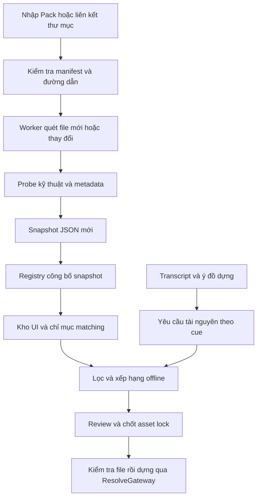

# Asset Registry & AI Matching Pipeline — thiết kế đề xuất

Ngày: 2026-10-25. Trạng thái: thiết kế để review; chưa triển khai.

## 1. Mục tiêu và hiện trạng

Kho tài nguyên dùng chung giữa các dự án, lưu bằng JSON UTF-8, hoạt động offline, không cần database server hoặc API trả phí. `assets/` hiện là dữ liệu thử nghiệm, không phải kho thật. Kho mẫu mặc định bị loại khỏi lựa chọn tự động; chỉ dùng khi bật chế độ demo rõ ràng.

Đối chiếu code hiện tại:

- `PackManager.install_pack()` mặc định giải nén vào `assets/`, ghi `data/installed_packs.json` tương đối với thư mục chạy.
- `AssetIndexer` đã hỗ trợ linked folders qua QSettings, nhưng ID hiện dựa trên đường dẫn; đổi vị trí có thể đổi ID. Thumbnail có thể được tạo bên cạnh file nguồn.
- `GlobalAssetPool` lập dictionary theo basename, có nguy cơ ghi đè khi trùng tên; tìm từ khóa bằng tên file và có thể trả kết quả đầu tiên.
- `StoryCopilot.get_available_assets_summary()` đọc thư mục mẫu, có mô tả meme hard-code; `CopilotMediaInsert` tham chiếu bằng `asset_file`.
- `Recipe` trong `recipe_manager.py` là preset cấu hình workflow. Kế hoạch dựng thực tế là `CopilotDirectorPlan`; không nhập hai khái niệm này thành một schema.

Ba hướng lưu trữ: một JSON khổng lồ đơn giản nhưng phải đọc/ghi toàn bộ; JSON chia theo nguồn có thể mở rộng và đáp ứng yêu cầu; database/vector store chỉ nên cân nhắc nếu yêu cầu thay đổi. Chọn JSON chia theo nguồn, có cache tìm kiếm trong RAM. Semantic embeddings là nâng cấp tùy chọn, không phải điều kiện để sử dụng.

“Web-Based (JSON)” được hiểu là dữ liệu mở, dễ xuất/nhập và dùng lại cho web UI. JSON tự nó không tạo web app; phiên bản này tiếp tục dùng PySide6, không thêm web server.

## 2. Thư mục và phạm vi tài nguyên

```text
<application>/assets/                      # bundled demo, chỉ đọc

<user-data>/ResolveFlow/library/           # registry, không nằm trong repo
  registry.json                           # nguồn đã đăng ký + snapshot đang hoạt động
  taxonomy.json                           # category, mood, scene, alias Việt/Anh
  overrides/<source_id>.json               # metadata người dùng chỉnh
  snapshots/<generation>/
    sources/<source_id>/catalog-0001.json  # asset records, tối đa 1.000/batch ban đầu
    search/<category>.json                # postings token -> asset_id, có thể tái tạo
  cache/thumbnails/<content_hash>.jpg
  cache/analysis/<content_hash>/<analyzer_version>.json

<media-root>/                              # mặc định library/media; được đổi ổ đĩa
  packs/<pack_id>/<version>/
    manifest.json                         # metadata pack + danh sách assets
    media/broll/...
    media/sfx/...
    media/bgm/...
    media/overlay/...
    media/lut/...
    previews/...                          # chỉ để preview, không phải media chèn
  imports/<source_id>/...                  # file người dùng chọn copy vào kho
  staging/<job_id>/...                     # chưa công bố cho matcher

<external-drive>/StockFootage/...          # linked: giữ nguyên, chỉ đọc

<project>/.resolveflow/
  asset-policy.json                       # nguồn cho phép, demo off, tùy chọn matching
  edit-plan.json                          # kế hoạch dựng
  assets.lock.json                        # asset_id, revision, checksum đã chốt
```

`user-data` lấy từ cơ chế app-data của Qt với tên ứng dụng ổn định, không phụ thuộc cwd. Ví dụ Linux dùng `$XDG_DATA_HOME` hoặc `~/.local/share`; Windows dùng vị trí app-data tương ứng của người dùng. Registry lưu đường dẫn nguồn thực tế trên máy; pack manifest chỉ chứa đường dẫn tương đối portable.

- **Managed pack:** app sở hữu thư mục đã cài; gỡ pack chỉ xóa thư mục này sau khi kiểm tra tham chiếu dự án đang biết.
- **Linked folder:** đăng ký đường dẫn, không copy, không ghi thumbnail vào nguồn, gỡ liên kết không xóa file. Mất ổ đĩa giữ nguồn trong registry và đánh dấu offline.
- **Project source:** video lời thoại và media dựng của dự án không tự động biến thành kho dùng chung. Người dùng có thể đăng ký một thư mục riêng làm kho của dự án.
- `category` là loại tài nguyên; `tags`, `emotion_tags`, `scene_types` là nhiều nhãn. Không nhân bản file vào các thư mục theo từng mood.
- Chỉ quét các nguồn đã được người dùng đăng ký; không tự quét toàn bộ ổ máy.

## 3. Hợp đồng JSON v1

### 3.1 Registry local

```json
{
  "schema_version": 1,
  "active_generation": "gen-000042",
  "sources": [
    {
      "source_id": "source-city-pack",
      "kind": "managed_pack",
      "root_path": "/mnt/Media/ResolveFlow/packs/community.city/1.0.0",
      "pack_id": "community.city",
      "pack_version": "1.0.0",
      "enabled": true,
      "demo_only": false,
      "availability": "online",
      "catalog_paths": ["sources/source-city-pack/catalog-0001.json"]
    }
  ]
}
```

`kind`: `bundled_demo | managed_pack | managed_import | linked | project`. `availability`: `online | offline | error`. `root_path` là thông tin local; không gửi vào prompt và không xuất vào pack cộng đồng. `catalog_paths` được giải tương đối với snapshot đang hoạt động.

### 3.2 Pack manifest và asset record

```json
{
  "schema_version": 1,
  "pack_id": "community.city",
  "version": "1.0.0",
  "name": "City Life",
  "author": "Community",
  "assets": [
    {
      "asset_id": "community.city:city-001",
      "revision": 1,
      "relative_path": "media/broll/city_morning.mp4",
      "display_name": "Phố buổi sáng",
      "category": "broll",
      "role": "insertable",
      "description": "Toàn cảnh phố đông người đi làm vào buổi sáng.",
      "tags": ["city", "traffic", "commute"],
      "emotion_tags": ["energetic"],
      "scene_types": ["urban", "establishing_shot"],
      "language": null,
      "media": {
        "format": "mp4",
        "video_codec": "h264",
        "audio_codec": null,
        "duration_ms": 12000,
        "width": 1920,
        "height": 1080,
        "fps_num": 25,
        "fps_den": 1,
        "has_audio": false
      },
      "usage": {
        "loopable": false,
        "allow_crop": true,
        "default_audio": "muted",
        "usable_ranges_ms": [[0, 12000]]
      },
      "type_metadata": {},
      "license": {
        "id": "unknown",
        "attribution": null,
        "reference": null
      },
      "metadata_origin": {
        "description": "pack_author",
        "tags": "pack_author",
        "emotion_tags": "pack_author",
        "media": "probe"
      }
    }
  ]
}
```

Ví dụ minh họa cấu trúc, không khai báo đây là pack đang có trên máy. Catalog local chuẩn hóa asset record trên và bổ sung `source_id`, `pack_id`, `pack_version`, `content_sha256`, `fingerprint: {size_bytes, mtime_ns}`, `status`, `metadata_revision`, `indexed_at`. Giá trị checksum thực được tính khi nhập hoặc quét nền; chưa tính thì null, không tạo checksum giả.

Các quy tắc schema bắt buộc khi triển khai:

| Trường | Quy tắc |
|---|---|
| `schema_version` | Integer được hỗ trợ; bản mới hơn không được âm thầm parse theo bản cũ |
| `asset_id` | String ổn định, namespace pack; file rời dùng UUID lưu bền vững. Không dựa trên basename hay đường dẫn tuyệt đối |
| `revision` | Integer >= 1; đổi nội dung phải có revision/checksum mới; đổi tag chỉ tăng metadata_revision local |
| `relative_path` | Đường dẫn tương đối nằm trong root; cấm absolute, `..` hoặc symlink thoát root |
| `category` | `broll`, `meme`, `sfx`, `bgm`, `overlay`, `lut`, `title`, `transition`, `unknown` |
| `role` | `insertable`, `preview`, `documentation`; chỉ insertable được matching để chèn |
| Nhãn | Array string unique; mã chuẩn trong taxonomy, UI hiển thị tiếng Việt |
| Thông số media | Kiểu số hữu hạn; duration >= 0; kích thước > 0 nếu có; fps_den > 0. Thiếu dữ liệu dùng null, không gán 0 giả |
| Ranges | Mỗi cặp start < end, nằm trong duration; đơn vị milliseconds |
| `status` | Local: `ready`, `pending`, `missing`, `corrupt`, `unsupported`, `needs_review` |
| `metadata_origin` | Nguồn từng trường: `user`, `pack_author`, `probe`, `filename_hint`, `local_model`; model có version/confidence riêng nếu dùng |

Ưu tiên metadata mô tả: người dùng > tác giả pack > model local > suy đoán tên file. Probe xác định thông số kỹ thuật thực; thông số pack không khớp phải được báo. File tên `001.mp4` thiếu mô tả vẫn được xem/chèn tay nhưng không được giả định AI đã hiểu cảnh.

Metadata theo loại đặt trong `type_metadata`: SFX có `event_type`/intensity; BGM có BPM, vocals, energy; overlay có alpha/blend mode; LUT có input/output color space, gamma và kích thước cube. Trường chưa biết là null. Không tự áp LUT chưa rõ tương thích màu, hoặc transition không có thao tác API được hỗ trợ. Các loại này có action riêng, không chèn như video.

`taxonomy.json` lưu mã chuẩn, nhãn Việt/Anh, aliases và mapping event -> SFX. Ví dụ `đi làm`, `commuting` -> `commute`; `bất ngờ` -> `surprised`. Bản có dấu được ưu tiên; bản bỏ dấu dùng để tăng recall, tránh đồng nhất mọi từ trùng sau bỏ dấu.

### 3.3 Kế hoạch dựng và asset lock

LLM sinh nhu cầu tài nguyên trước; matcher trả asset ID. Không cho LLM tự suy ra đường dẫn.

```json
{
  "plan_schema_version": 2,
  "manifest_id": "source-project-001",
  "asset_registry_generation": "gen-000042",
  "broll_inserts": [
    {
      "cue_id": "cue-007",
      "timeline_sec": 12.0,
      "duration_sec": 3.5,
      "asset_type": "broll",
      "asset_id": "community.city:city-001",
      "asset_revision": 1,
      "src_in": 0.0,
      "match_status": "matched",
      "description": "Minh họa cảnh đi làm buổi sáng",
      "request": {
        "keywords": ["city", "commute"],
        "emotion": "energetic",
        "scene_type": "urban",
        "exclude_tags": ["night"]
      }
    }
  ]
}
```

`assets.lock.json` do ứng dụng ghi sau validation, lưu source_id/location tương đối, asset_id, revision, checksum thực, khoảng nguồn đã chọn, score/thành phần score và lý do. Không tin checksum do LLM trả. Mỗi plan đã chốt phải kiểm tra file còn đúng trước khi dựng. Nếu hash chưa có, tính cho các file được chọn rồi mới chốt lock.

`manifest_id` hiện có vẫn là ID nguồn dự án; không dùng nó cho pack manifest. `timeline_sec` tính trên timeline rough-cut đầu ra; cue từ transcript nguồn phải qua ánh xạ edit decision trước. Chuyển sang frame một lần theo fps timeline, kiểm tra giới hạn và offset timeline start tại tầng Resolve.

## 4. Matching offline

### Bước 1 — tạo yêu cầu

Từ transcript, ý đồ dựng và vị trí trong rough-cut, tạo AssetRequest gồm category, keyword/topic, emotion, scene type, event, duration, tỷ lệ khung hình, ràng buộc sử dụng. Có thể do LLM local hoặc rule-based tạo. Không cần LLM để duyệt kho, tìm tag hay matching cơ bản.

### Bước 2 — lọc bắt buộc

Loại nguồn disabled/offline, demo khi chưa bật, preview, missing/corrupt, loại asset sai, tag bị loại, file chưa có action phù hợp, hoặc không đáp ứng ràng buộc cứng. Kiểm tra license theo chính sách người dùng; unknown không được hiển thị là miễn bản quyền. Không ép BGM và SFX dùng cùng tiêu chí độ dài.

- B-roll cần đoạn nguồn đủ dài; thiếu thì chọn clip khác hoặc đề nghị rút ngắn cue, không tự freeze/stretch.
- SFX có thể ngắn hơn cửa sổ cue; không kéo dài tiếng pop thành 3 giây.
- BGM chỉ loop khi metadata cho phép; nếu không đủ, đề nghị đoạn ngắn hơn hoặc bỏ.
- LUT cần tương thích color space; transition native chuyển sang hướng dẫn/needs_review nếu không có API áp dụng.

### Bước 3 — tìm ứng viên và chấm điểm

Chuẩn hóa Unicode, từ/cụm từ, alias và tra inverted index theo category. Match tên chỉ là một tín hiệu; ưu tiên tag/mô tả. Các nhãn do suy đoán tên file có trọng số thấp hơn nhãn người dùng/tác giả.

Công thức khởi đầu, các thành phần trong [0,1]:

`score = 0.45*topic + 0.20*scene_or_event + 0.15*mood + 0.10*duration_fit + 0.10*format_fit - repetition_penalty`

- Topic: tỷ lệ từ/cụm từ yêu cầu được phủ bởi tag/mô tả sau alias; khớp cụm đầy đủ được ưu tiên.
- Scene/event: scene cho B-roll, event cho SFX, ngữ cảnh dùng nhạc cho BGM.
- Mood: mã cảm xúc và nhóm tương thích có khai báo trong taxonomy.
- Duration/format: khả năng đáp ứng thời lượng và khung hình theo chính sách crop/loop.
- Không yêu cầu một tiêu chí thì bỏ trọng số đó và chuẩn hóa lại các trọng số còn lại; thiếu metadata cho tiêu chí được yêu cầu thì thành phần đó bằng 0.
- Phạt lặp trong cùng dự án, khởi điểm 0.15 mỗi lần đã sử dụng, tối đa 0.45; giải hòa bằng asset_id ổn định. Không dùng ngẫu nhiên không có seed.
- Bắt buộc có tín hiệu topic hoặc event phù hợp; chỉ khớp mood/khung hình không đủ để tự chèn.

Ngưỡng thử nghiệm: >= 0.65 tự chọn; 0.45–0.65 đưa Review; < 0.45 bỏ qua. Đây là tham số cần hiệu chỉnh bằng bộ cue gán nhãn, không phải xác suất đúng hay cam kết chất lượng.

Lấy top 20 để xếp hạng, đưa tối đa top 5/cue vào prompt nếu có LLM rerank. LLM chỉ chọn ID trong danh sách hoặc `none`; validator từ chối ID lạ. Không nhét toàn bộ hàng nghìn file vào prompt. Nếu LLM lỗi hoặc chưa có model, giữ kết quả rule-based đủ ngưỡng, còn mơ hồ đưa Review.

### Bước 4 — kiểm tra và chốt

Resolver biến ID thành file từ nguồn đăng ký; re-stat, đối chiếu checksum/revision, khả năng đọc/format và source range. File đã đổi thì invalidation và rematch/review; không tự thay nội dung của một plan đã duyệt. Chỉ sau đó mới tạo action cho timeline qua ResolveGateway/bridge.

Semantic search là giai đoạn sau: model local đã tải sẵn có thể tạo mô tả hoặc embedding theo content hash + model/version. Vector nếu có vẫn lưu JSON chia shard theo yêu cầu, dùng cache RAM khi tìm. Cần benchmark dung lượng/tốc độ trước khi bật rộng; không giả định JSON vector sẽ nhẹ cho kho rất lớn. Không có model thì chức năng cơ bản vẫn đầy đủ. Cài model/pack lần đầu là tác vụ riêng có thể cần mạng; index/match/dựng không được tự gọi internet.

## 5. Luồng nhập và sử dụng



Pack tải từ Drive/web chỉ là đầu vào downloader; file đã tải đi qua cùng importer như pack offline. Không bắt matcher phụ thuộc Drive. Phân biệt nút nhập video nguồn AI Director với nút nhập Asset Pack vào Library.

Quy trình quét: enumerate nhẹ -> so size/mtime_ns -> chỉ probe/hash/thumbnail file mới hoặc đổi -> ghép metadata và overrides -> ghi snapshot -> công bố. Hash toàn bộ kho lớn không chặn UI; chạy nền một lần, sau đó chỉ xử lý thay đổi. Fingerprint chỉ là shortcut, có chế độ kiểm tra toàn vẹn bằng checksum và kiểm tra file được chọn trước dựng. Không tự chạy Whisper cho B-roll/SFX/BGM. Transcript của nguồn lời thoại là cache riêng.

Worker có progress/cancel; không gọi ffprobe hoặc đọc hash lớn trên GUI thread. Linked folder read-only được hỗ trợ; theo dõi filesystem chỉ là gợi ý, có refresh thủ công để bù sự kiện bị mất.

Một writer có khóa tiến trình cho registry. Ghi các shard snapshot vào thư mục mới, validate, rồi atomic replace `registry.json` trên cùng filesystem để chuyển generation. Reader giữ snapshot cũ cho đến khi snapshot mới hoàn chỉnh. Hủy/crash trước công bố không làm mất kho cũ; dọn staging và snapshot không còn được dùng sau. Search cache hỏng có thể tái tạo từ catalog, không xóa metadata/overrides.

Pack cập nhật cài cạnh phiên bản cũ; asset_id chỉ giữ nguyên khi tác giả giữ cùng định danh logic. Revision/hash khóa đúng nội dung. Không tự gỡ bản cũ đang được dự án đã biết sử dụng. File linked bị sửa tại chỗ thì không bảo đảm render lặp lại; lựa chọn “Đóng gói dự án” copy các file đang dùng kèm lock để lưu trữ/đổi máy.

## 6. Edge cases

| Tình huống | Hành vi |
|---|---|
| Kho trống | Rough-cut vẫn chạy với nguồn chính; danh sách unmet requests, không fallback lén về assets demo |
| Không khớp | `asset_id: null`, `match_status: unmatched`; bỏ lớp minh họa, giữ hình/tiếng chính; gợi ý tag/loại pack nên bổ sung |
| Placeholder | Chỉ marker/note cần bổ sung nếu người dùng bật; không chèn clip đen/tím/demo |
| File bị xóa | Mark missing; loại khỏi matching; plan cũ báo thiếu và yêu cầu relink/rematch |
| Ổ linked offline | Mark source offline; giữ catalog, ID, nhãn và thumbnail; không kết luận toàn bộ file bị xóa |
| Folder chuyển vị trí | Đổi root của source giữ source_id; kiểm tra relative_path/checksum, không đổi ID hàng loạt |
| File đổi tên/chuyển trong nguồn | Dò checksum để relink khi xác định duy nhất; nếu nhiều bản thì review; không đoán theo basename |
| Trùng tên khác nội dung | ID khác, không ghi đè; recipe cũ theo tên chỉ resolve nếu duy nhất |
| Trùng nội dung | Nhận diện bằng full hash; nhóm kết quả để tránh lặp nhưng giữ provenance/license của từng asset; không tự xóa hoặc gộp ID |
| Nội dung thay đổi tại cùng path | Fingerprint/hash mới, tăng revision local, vô hiệu hóa analysis; plan đã khóa không âm thầm dùng bản mới |
| ZIP không manifest | Wizard xác nhận loại và mô tả nhóm; tạo ID/manifest; không đoán mọi audio là SFX hoặc mọi video là meme |
| File lỗi/không hỗ trợ | Quarantine trạng thái, ghi lý do; tiếp tục scan file khác |
| Pack path traversal/symlink | Chặn đường dẫn thoát staging/root; giới hạn số file/kích thước giải nén; không chạy script trong pack |
| Metadata hướng dẫn AI | Xem mô tả pack là dữ liệu, không là lệnh; schema, allowlist ID và resolver quyết định action |
| Scan bị hủy/JSON hỏng | Giữ generation tốt gần nhất; lỗi hiển thị rõ; không thay registry bằng danh sách rỗng |
| Gỡ pack | Chỉ xóa managed paths của pack; cảnh báo các plan đã biết bị ảnh hưởng; external chỉ unlink |

## 7. Tích hợp và thứ tự triển khai

Các module mới dự kiến: `asset_registry.py` (nguồn/snapshot/resolve), `asset_manifest.py` (validate schema), `asset_matcher.py` (request/ranking). Tái dùng probe/indexer hiện có qua worker; không tạo một scanner độc lập cạnh tranh với nó.

1. Registry + đường dẫn dữ liệu + importer: hỗ trợ managed/linked/demo, schema/version, ID và incremental scan. Đọc registry pack cũ và linked QSettings một lần, có migration marker/backup. Không tự di chuyển/xóa `assets/`; phân loại pack người dùng đã cài dựa trên installed_paths, mục không rõ đưa review.
2. Matching rule-based + taxonomy + Review: có score/reasons/unmatched. UI Model/View lấy cùng snapshot như matcher, giữ ảo hóa.
3. `StoryCopilot`: thay hard-code summary bằng truy vấn ứng viên, mở rộng `CopilotMediaInsert` với ID/revision/request/status. Giữ các trường cũ để đọc plan legacy; fallback basename chỉ khi duy nhất và thuộc nguồn được cho phép. Thêm action/schema riêng cho BGM/overlay/LUT thay vì ép tất cả vào broll_inserts.
4. `GlobalAssetPool`: trở thành adapter gọi registry; giữ aliases public để không phá caller. `PackManager` cài vào media-root, `AssetIndexer` cung cấp catalog thống nhất. `InsertService` dùng resolver cho file thật, giữ logic audio track/recordFrame và LUT clip scope hiện có.
5. Test thực tế trên project Resolve riêng; semantic enrichment chỉ bổ sung sau khi baseline đạt.

## 8. Tiêu chí nghiệm thu

- Không có pack user, demo tắt: không có asset mẫu được tự chèn, rough-cut vẫn tạo được.
- Hai pack cùng basename: đúng asset ID được chọn, không ghi đè hoặc resolve nhầm.
- Restart và rescan không đổi file: không probe/hash/Whisper lại hàng loạt; thêm một file chỉ xử lý phần mới.
- Chỉnh tags thủ công rồi rescan/update pack: override không mất.
- Đổi root/ổ mất kết nối: ID và metadata được bảo toàn; plan không báo thành công giả.
- Rút asset sau khi đã chọn: preflight bắt được trước thao tác Resolve.
- Match có bằng chứng tag/topic/event; thiếu match giữ nguồn chính, không chèn placeholder media.
- Tắt mạng và không có Ollama: import local, browse, rule-based matching vẫn hoạt động.
- Chỉ chạy test tập trung cho registry/matcher và caller đã sửa; không chạy toàn bộ suite. Đo riêng kho 1k/10k assets về thời gian mở lại, RAM, query latency và cancel responsiveness; chưa cam kết con số trước benchmark.

Tài liệu này là đề xuất; không xác nhận registry/matcher mới đã được triển khai hoặc kiểm thử.
